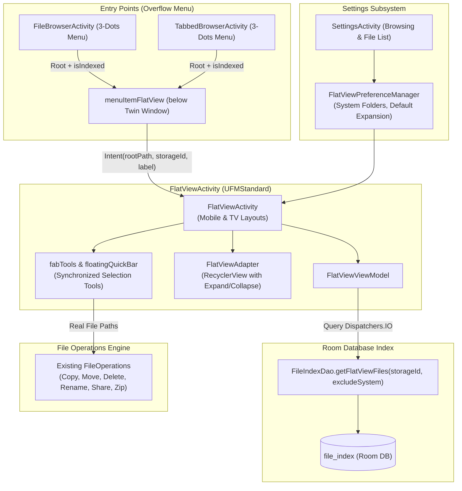

# Implementation Plan: Flat View (Indexed Root Browser Mode)

## Goals
Implement **Flat View**, an expandable/collapsible virtual browsing layout for Ultimate File Manager Pro (UFM) that enables users to browse all files across deeply nested subdirectories from the root folder of any indexed storage volume.

### Success Criteria (from `spec.md` & `clarifications.md`):
- Accessible exclusively from the root folder of indexed storages via the 3-dots overflow menu directly below Twin Window (`menuItemFlatView`).
- Queries directly from the Room `file_index` database table for instant rendering across 100,000+ files.
- Grouped by direct parent section headers displaying relative paths (e.g., `Documents/Work/2026/ (12 files)`), with all folders expanded by default.
- Tapping any folder header or the root header toggles its collapsed/expanded state with smooth differential RecyclerView updates.
- Folder headers feature an "Open Folder" action button to jump to standard hierarchical browsing at that specific folder.
- `Android/data` and `Android/obb` are excluded by default, toggleable via Settings.
- Full parity for normal Edit Mode, multi-select, Tools FAB (`fabTools`), and Floating Quick Action Bar (`floatingQuickBar`).
- Checking a folder header in Edit Mode automatically cascades selection to all contained files; "Select All" selects files across both expanded and collapsed folders.
- All file operations (copy, move, delete, rename, share, zip, properties) target real physical source paths.
- Dedicated "Flat View" configuration card in `SettingsActivity` under "Browsing & File List".
- Full Android TV remote/D-pad navigation and `UFMStandard` UI compliance (Mobile 56dp glass header, TV 72dp glass header, D-pad focus states).

---

## Architecture Overview



---

## Files to Create

### 1. `app/src/main/java/za/kilowatch/ultimatefilemanager/flatview/FlatViewActivity.kt`
- **What**: The primary Activity hosting Flat View, complying with `UFMStandard` and project activity rules.
- **Key details**:
  - Overrides `attachBaseContext` via `LocaleManagerWrapper.setLocale(this, super.attachBaseContext(newBase))`.
  - Edge-to-edge setup via `EdgeToEdge.enable(this)` in `onCreate()` and window inset application.
  - Dynamically loads `activity_flat_view.xml` (Mobile) or `activity_flat_view_tv.xml` (TV) using `DeviceUtils.isTvDevice(this)`.
  - Coordinates ViewModel state, search/filter queries, folder collapse/expand events, and Edit Mode selection.
  - Integrates `fabTools` and `floatingQuickBar` for file operations.

### 2. `app/src/main/java/za/kilowatch/ultimatefilemanager/flatview/FlatViewViewModel.kt`
- **What**: ViewModel managing indexed data fetching, in-memory grouping, filtering, and selection state.
- **Key details**:
  - Loads data via `FileIndexDao` on `Dispatchers.IO`.
  - Groups items by immediate parent `folderPath`, builds relative display paths, and initializes all folders as expanded (or as configured in preferences).
  - Emits UI states: `Loading`, `Content(items, isFiltered, totalFiles, totalFolders)`, `Empty`, `Error`.
  - Handles real-time in-memory text filtering without re-querying the database.

### 3. `app/src/main/java/za/kilowatch/ultimatefilemanager/flatview/FlatViewAdapter.kt`
- **What**: Virtualized `RecyclerView.Adapter` rendering folder headers and file entries.
- **Key details**:
  - Item types: `VIEW_TYPE_ROOT_HEADER`, `VIEW_TYPE_FOLDER_HEADER`, `VIEW_TYPE_FILE`.
  - Folder headers: chevron toggle, folder name, relative path, file count chip, checkbox in edit mode, and "Open Folder" navigation icon.
  - File rows: file icon / thumbnail loading via Glide/coil/UFM thumbnail loader, filename, relative parent path, file size, last modified date, and checkbox in edit mode.
  - Differential list updates (`notifyItemRangeInserted` / `notifyItemRangeRemoved`) on folder collapse/expand for maximum efficiency.
  - D-pad focus listeners and high-contrast yellow focus highlight on TV.

### 4. `app/src/main/java/za/kilowatch/ultimatefilemanager/flatview/FlatViewItem.kt`
- **What**: Data model representing items in the flattened adapter list.
- **Key details**:
  - `FlatFolderHeader`: `folderPath`, `relativePath`, `fileCount`, `isExpanded`, `isSelected`, `isRoot`.
  - `FlatFileEntry`: `fileIndex: FileIndex`, `relativeParentPath`, `isSelected`.

### 5. `app/src/main/java/za/kilowatch/ultimatefilemanager/settings/FlatViewPreferenceManager.kt`
- **What**: Shared preference manager for Flat View settings.
- **Key details**:
  - `isSystemFoldersIncluded(context): Boolean` (Default: false)
  - `setSystemFoldersIncluded(context, enabled: Boolean)`
  - `isDefaultExpanded(context): Boolean` (Default: true)
  - `setDefaultExpanded(context, expanded: Boolean)`
  - `getContentMode(context): String` (Default: "files_only")

### 6. Layouts & Drawables:
- `app/src/main/res/layout/activity_flat_view.xml` (Mobile layout with 56dp frosted glass header, filter bar, RecyclerView, `fabTools`, `floatingQuickBar`).
- `app/src/main/res/layout/activity_flat_view_tv.xml` (Android TV layout with 72dp glass header, TV button selectors, and 10-foot UI styling).
- `app/src/main/res/layout/item_flat_folder_header.xml` (Mobile folder section header).
- `app/src/main/res/layout/item_flat_folder_header_tv.xml` (TV folder section header with D-pad focus).
- `app/src/main/res/layout/item_flat_file.xml` (Mobile file row with relative path).
- `app/src/main/res/layout/item_flat_file_tv.xml` (TV file row with relative path and TV focus styling).
- `app/src/main/res/drawable/ic_flat_view.xml` (Vector icon for Flat View).

---

## Files to Modify

### 1. `app/src/main/res/layout/popup_header_options_menu.xml`
- **Change**: Add divider and `menuItemFlatView` directly below `menuItemTwinWindow`.

### 2. `app/src/main/java/za/kilowatch/ultimatefilemanager/storage/FileBrowserActivity.kt`
- **Change**:
  - In `showOverflowMenu()`: Check if at storage root (`currentDir.absolutePath == rootPath`) and storage is fully indexed (`UfmApplication.indexingRepository.isStorageFullyIndexed(storageId)`).
  - Bind `menuItemFlatView` click to launch `FlatViewActivity`.
  - If TV, wire TV header button/menu if applicable.

### 3. `app/src/main/java/za/kilowatch/ultimatefilemanager/tabs/TabbedBrowserActivity.kt`
- **Change**:
  - In `showOverflowMenu()`: When current active tab is at indexed root, show `menuItemFlatView` and wire click to launch `FlatViewActivity`.

### 4. `app/src/main/java/za/kilowatch/ultimatefilemanager/indexing/FileIndexDao.kt`
- **Change**:
  - Add `@Query` method `getFlatViewFiles(storageId: String, excludeSystem: Boolean): List<FileIndex>` for optimized fetching and filtering.

### 5. `app/src/main/java/za/kilowatch/ultimatefilemanager/settings/SettingsActivity.kt`
- **Change**:
  - Add `cardFlatView` in the "Browsing & File List" section (`applySettingsCardIcons()`, click listener opening Flat View options dialog or bottom sheet).

### 6. `app/src/main/java/za/kilowatch/ultimatefilemanager/settings/SettingsTransferManager.kt`
- **Change**:
  - Register Flat View preferences in backup/restore registry so preferences persist across exports.

### 7. `app/src/main/AndroidManifest.xml`
- **Change**:
  - Register `FlatViewActivity` with orientation and configuration change handling.

### 8. `app/src/main/res/values/strings.xml`
- **Change**:
  - Add translatable string resources: `flat_view`, `flat_view_subtitle`, `flat_view_open_folder`, `flat_view_expand_all`, `flat_view_collapse_all`, `flat_view_include_system_folders`, `flat_view_include_system_folders_desc`, `flat_view_default_expanded`, `flat_view_empty_notice`.

---

## Data Model & Query Details

```kotlin
// In FileIndexDao.kt
@Query("""
    SELECT * FROM file_index
    WHERE storageId = :storageId
    AND isDirectory = 0
    AND (:excludeSystem = 0 OR (path NOT LIKE '%/Android/data%' AND path NOT LIKE '%/Android/obb%'))
    ORDER BY folderPath ASC, filename ASC
""")
suspend fun getFlatViewFiles(storageId: String, excludeSystem: Boolean): List<FileIndex>
```

---

## Dependencies
- No new external libraries required. Uses existing AndroidX, Room, Coroutines, Material3 Expressive, and UFM components.

---

## Verification Plan

### Automated Tests
- Unit test for `FlatViewViewModel` data grouping and collapse/expand logic.
- Unit test for `FileIndexDao.getFlatViewFiles` query with and without system folder exclusion.
- Gradle build verification: `./gradlew assembleMobileGoogleDebug` to guarantee zero build errors and clean compilation.

### Manual Verification
1. Open UFM on an indexed storage (e.g. Internal Storage) at root folder.
2. Tap the 3-dots menu on top right: verify `Flat View` appears directly below `Twin Window`.
3. Tap `Flat View`: verify `FlatViewActivity` opens with all folders expanded by default.
4. Verify subfolder headers show relative paths (e.g. `Documents/Invoices/`) and file counts.
5. Tap a folder header: verify it collapses smoothly. Tap again: verify it expands.
6. Tap the "Open Folder" action on a folder header: verify it jumps to standard browser at that directory.
7. Long-press a file: verify Edit Mode activates, `fabTools` and `floatingQuickBar` appear.
8. Check a folder header checkbox: verify all files inside that folder become selected.
9. Tap "Select All": verify files across both expanded and collapsed folders are selected.
10. Execute a file operation (e.g., Copy, Rename, or View Details): verify it targets the real file path.
11. Navigate to Settings -> "Browsing & File List" -> "Flat View": toggle "Include System Folders" ON; re-open Flat View and verify `Android/data` appears.
12. Verify Android TV D-pad navigation, focus highlights, and back button behavior.

---

## Risks & Mitigations
- **Large Dataset (>100,000 files) Memory**: Differential adapter updates (`notifyItemRangeInserted` / `notifyItemRangeRemoved`) prevent re-binding the entire list during expand/collapse.
- **Stale Index Data**: Before executing any file operation via `fabTools`, check `file.exists()`. If missing, display a prompt and refresh.
- **Deep Nesting Visual Clutter**: Folder headers display direct parent paths rather than multi-level indentation, keeping the UI clean and readable on both phone and TV screens.
