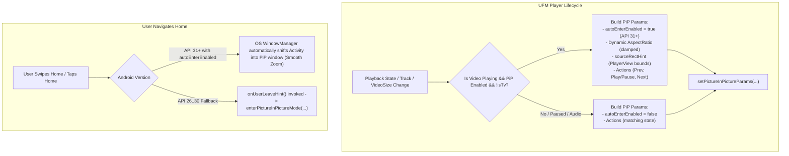

# Implementation Plan: Picture-in-Picture Compatibility for Custom Launchers and Modern Android

## Goals
- Enable seamless, launcher-agnostic automatic Picture-in-Picture entry when navigating home (gesture swipe or Home button) while playing video, resolving the issue where custom launchers (such as One4Home, Nova, Lawnchair) fail to trigger PiP.
- Implement Android 12+ (API 31+) `setAutoEnterEnabled(true)` on `PictureInPictureParams` when video playback is active and PiP background mode is enabled.
- Automatically disable `autoEnterEnabled` (`false`) when video is paused, when an audio file is playing, or when Background Video Mode is set to "Audio Only", satisfying Q1, Q3, and Q4 clarifications.
- Dynamically detect and configure the video's actual aspect ratio from ExoPlayer (`videoWidth : videoHeight`, clamped to Android's allowed range `1:2.39` to `2.39:1`) with rotation awareness, and supply `sourceRectHint` for fluid zoom-to-home transitions (satisfying Q2 clarification).
- If playing a playlist in PiP mode and playback advances to an audio-only track, automatically dismiss the PiP window (`finish()`) while maintaining audio playback via `UFMPlaybackService` in the background (satisfying Q3 clarification).
- Maintain robust backwards-compatibility for Android 8.0–11 (API 26–30) via `onUserLeaveHint()`.

---

## Architecture Overview

### Root Cause Analysis
In current code (`UFMPlayerActivity.kt`), PiP mode entry is initiated solely inside `onUserLeaveHint()` by calling `enterPictureInPictureMode(...)`. 
- On modern Android (Android 12+ / API 31+), custom launchers (like One4Home, Nova Launcher, Lawnchair) often do not invoke `onUserLeaveHint()` when the user performs a swipe-to-home gesture or presses the home button, because task switching and recents transitions are handled at the OS gesture navigation layer. Stock launchers like Samsung OneUI trigger `onUserLeaveHint()`, which is why PiP worked under OneUI but failed under One4Home.
- Android 12 introduced `PictureInPictureParams.Builder.setAutoEnterEnabled(true)`. When this parameter is supplied to `setPictureInPictureParams(...)` while the activity is in the foreground, the Android WindowManager automatically transitions the activity into PiP during the home gesture or home press, completely bypassing the launcher and eliminating reliance on `onUserLeaveHint()`.



---

## Files to Create
*None (All changes are contained within the existing media player activity architecture).*

---

## Files to Modify

### `app/src/main/java/za/kilowatch/ultimatefilemanager/viewer/UFMPlayerActivity.kt`
- **What:** Modernize PiP parameter construction, dynamic video aspect ratio calculation, source rect hint tracking, auto-enter management, and playlist audio transition handling.
- **Key Details:**
  1. **Consolidated PiP Builder (`buildPiPParams(isPlaying: Boolean)`):**
     - Construct `PictureInPictureParams.Builder()`.
     - Configure remote actions: Previous, Play/Pause, Next.
     - Calculate dynamic aspect ratio from `player?.videoSize` with unapplied rotation handling (swapping width and height if rotation is 90° or 270°), clamped safely between `Rational(100, 239)` and `Rational(239, 100)` using greatest common divisor (GCD) simplification.
     - Set `sourceRectHint` from `playerView` global visible bounds when `playerView` is visible.
     - On API 31+ (`Build.VERSION.SDK_INT >= Build.VERSION_CODES.S`), set `setAutoEnterEnabled(canAutoEnter)` where:
       ```kotlin
       val isVideo = currentTrackInfo?.isVideo == true || playbackService?.currentQueueItem?.isVideo == true
       val pipEnabled = PlayerPreferencesManager.getBackgroundVideoMode(this) == BackgroundVideoMode.PIP
       val canAutoEnter = isPlaying && isVideo && pipEnabled && !isTv
       ```
  2. **Lifecycle & State Updates (`updatePiPParams()`):**
     - Call `updatePiPParams()` in:
       - `onPlaybackStateChanged(isPlaying: Boolean, state: Int, isLocal: Boolean)`: immediately updates actions and toggles `autoEnterEnabled` between playing and paused states.
       - `activityPlayerListener.onVideoSizeChanged(videoSize: VideoSize)`: updates aspect ratio as soon as the media dimensions are parsed or change.
       - `playbackCallback.onTrackChanged(trackInfo: QueueItem?)`: updates track parameters. If in PiP mode (`isPiP == true`) and `trackInfo?.isVideo != true`, invoke `finish()` to seamlessly transition to background audio service.
       - `onResume()`: refreshes PiP params when returning to foreground.
       - `playerView` layout listener: refreshes `sourceRectHint` once view layout completes.
  3. **Refactored `onUserLeaveHint()`:**
     - On API < 31 (or if `!isInPictureInPictureMode` on API 31+), maintain safe fallback calling `enterPictureInPictureMode(buildPiPParams(true).build())`.
     - When leaving foreground with audio-only or PiP disabled while playing, maintain `finish()` so playback service continues smoothly in background.

---

## Data Model
No database schema or SharedPreferences schema changes required. Existing `BackgroundVideoMode` (`PIP` vs `AUDIO_ONLY`) in `PlayerPreferencesManager` is fully reused.

---

## Dependencies
- AndroidX Media3 Common `VideoSize` (already present in project dependencies).
- Android OS Platform API `PictureInPictureParams.Builder.setAutoEnterEnabled` (introduced in API 31, guarded with `Build.VERSION.SDK_INT >= Build.VERSION_CODES.S`).

---

## Test Plan

### Automated Build Verification
```bash
./gradlew assembleMobileGoogleDebug
```

### Manual Verification
1. **Third-Party Launcher Test (One4Home / Nova / Lawnchair)**:
   - Set default home app to One4Home or another third-party launcher.
   - Open UFM, play any video file.
   - Perform swipe-up gesture or tap Home button.
   - **Verify:** Video player automatically enters PiP mode without stopping or closing.
2. **Stock Launcher Test (Samsung OneUI / Pixel Launcher)**:
   - Play video and navigate home.
   - **Verify:** PiP continues to work flawlessly.
3. **Paused State Test**:
   - Pause the video.
   - Navigate home.
   - **Verify:** Does not enter PiP; minimizes normally to background.
4. **Audio-Only Mode Test**:
   - In Settings, set Background Video Mode to "Audio Only" (or play an MP3/FLAC file).
   - Navigate home.
   - **Verify:** Player does not enter PiP; audio continues playing in background notification.
5. **Aspect Ratio Test**:
   - Play a 16:9 video, a 21:9 ultra-wide video, and a 9:16 vertical video.
   - Enter PiP.
   - **Verify:** PiP window matches the video's aspect ratio without black bars or distortion.
6. **Mixed Playlist Test in PiP**:
   - Queue a video followed by an audio track.
   - Enter PiP and tap Next (or wait for video to end).
   - **Verify:** PiP window dismisses cleanly, and audio continues playing via the playback notification.

---

## Risks & Mitigations
- **Risk:** Aspect ratios outside Android system bounds throw `IllegalArgumentException` on `setAspectRatio`.  
  **Mitigation:** Enforce strict mathematical clamping between `1/2.39` (`Rational(100, 239)`) and `2.39` (`Rational(239, 100)`).
- **Risk:** Rotation degrees (e.g. portrait video recorded at 90° or 270°) cause inverted aspect ratio calculations.  
  **Mitigation:** Inspect `videoSize.unappliedRotationDegrees` and swap width/height when rotation is 90° or 270°.
- **Risk:** Rapid multitasking or calling `setPictureInPictureParams` before views are laid out.  
  **Mitigation:** Guard all view bounds calculations with `::playerView.isInitialized` and wrap `setPictureInPictureParams` in a try-catch block.
