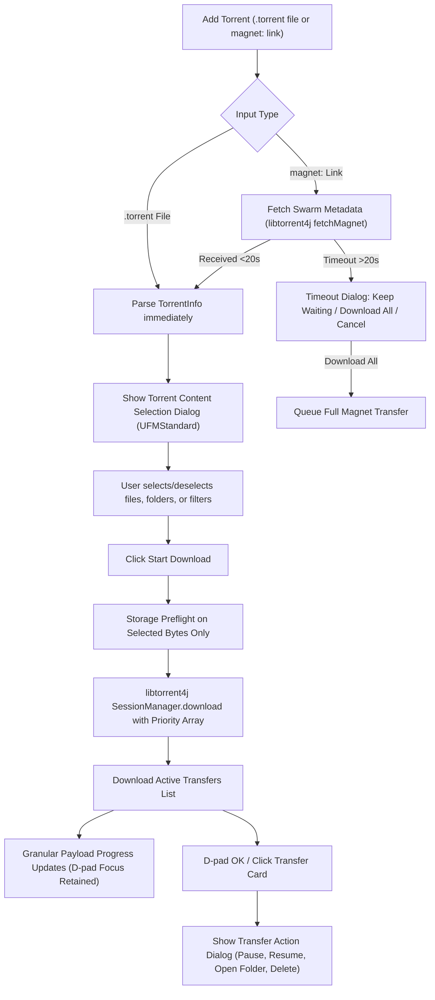

# Implementation Plan: Torrent & Magnet Selective File Download & TV Focus Stability

## Overview
This plan defines the architectural design and implementation steps for:
1. **Selective File & Folder Download Inspector**: Prior to initiating torrent or magnet downloads, inspect the torrent hierarchy in a scrollable, collapsible tree dialog. All items are selected by default, with one-tap "Select All" / "Deselect All", category filters (Videos, Audio, Docs, etc.), real-time size computation, and `libtorrent4j` priority masking (`Priority.DEFAULT` vs `Priority.IGNORE`).
2. **Android TV Focus Stability & Transfer Action Dialog**: Fix the D-pad focus loss issue on Android TV where active downloads cause the RecyclerView to reset focus to the top toolbar every second. Implement granular payload updates, stable IDs, and a dedicated UFMStandard TV Transfer Action Dialog allowing users to pause, resume, open download folders, or delete transfers via D-pad remote.



---

## User Review Required

> [!IMPORTANT]
> **Android TV Layout Split**: Android TV will use an **800dp wide two-column layout** (`dialog_torrent_file_selection_tv.xml`). The left column houses summary stats and action buttons, while the right column houses the scrollable file tree, ensuring instant D-pad accessibility without needing to scroll past hundreds of files.

> [!IMPORTANT]
> **Pre-download Scope Boundary**: File selection and priority masking happen prior to starting the transfer. Changing file priorities on already active in-progress downloads is deferred to a future milestone.

---

## Proposed Changes

### Component 1: Torrent Content Data Model & Hierarchy Parser

#### [NEW] `app/src/main/java/za/kilowatch/ultimatefilemanager/download/TorrentFileNode.kt`
- Data structure representing a node in the torrent file tree (either a folder or a file).
- Contains:
  - `id: Int`
  - `path: String` (full relative path inside the torrent)
  - `name: String` (leaf file or folder name)
  - `sizeBytes: Long` (file size or accumulated directory size)
  - `var isSelected: Boolean = true`
  - `val isDirectory: Boolean`
  - `val fileIndex: Int` (-1 for directories, >= 0 for leaf files corresponding to `TorrentInfo.files()`)
  - `val children: MutableList<TorrentFileNode>`
  - `var isExpanded: Boolean = true`
- Companion object builder `fromTorrentInfo(torrentInfo: TorrentInfo): TorrentFileNode`:
  - Parses flat file lists from `TorrentInfo` (e.g., `Season 1/Episode 01.mkv`) into nested nodes.
  - Recursively aggregates folder sizes and child counts.
  - Helper functions for recursive toggling:
    - `setSelectionRecursive(selected: Boolean)`
    - `isAllSelected(): Boolean`
    - `isNoneSelected(): Boolean`
    - `getSelectedBytes(): Long`
    - `getSelectedFileIndices(): Set<Int>`
    - `buildPriorityArray(totalFiles: Int): Array<Priority>`

---

### Component 2: Selective Torrent Engine Integration

#### [MODIFY] `app/src/main/java/za/kilowatch/ultimatefilemanager/download/TorrentEngine.kt`
- Update `downloadTorrentFile(torrentFile: File, saveDir: File, filePriorities: Array<Priority>? = null)`:
  - Pass `filePriorities` directly into `sessionManager.download(torrentInfo, saveDir, null, filePriorities, null, flags)`.
- Implement `fetchMagnetMetadata(magnetUri: String, timeoutSeconds: Int = 20, onResult: (File?) -> Unit)`:
  - Dispatches `sessionManager.fetchMagnet(magnetUri, timeoutSeconds, tempDir)` on an IO coroutine or worker thread.
  - Caches the retrieved torrent bytes into a temporary `.torrent` file in `cacheDir/torrents/` and returns it for inspection.
- Update `handleTorrentFinished(handle: TorrentHandle)`:
  - Enforce zero-seeding compliance.
  - Clean up any 0-byte boundary chunk files or empty directories left behind by deselected files (`Priority.IGNORE`).
  - Scan only the downloaded files with `Priority > 0` into the Android MediaStore.

#### [MODIFY] `app/src/main/java/za/kilowatch/ultimatefilemanager/download/DownloadTransferManager.kt`
- Overload `startTorrentFileDownload`:
  - Accept `selectedFileIndices: Set<Int>? = null` and `customTotalBytes: Long? = null`.
  - Pass the calculated `effectiveTotalBytes` into `StoragePreflightValidator.validate`.
  - Pass the generated `Priority[]` array to `TorrentEngine`.
  - Update `TransferItem.totalBytes` to reflect the selected payload size.

---

### Component 3: File Selection UI & Adapters

#### [NEW] `app/src/main/res/layout/dialog_torrent_file_selection.xml` (Mobile)
- Responsive UFMStandard glass layout (`@drawable/bg_dialog_glass`):
  - Top Badge + Torrent Title + Summary Statistics (`Selected: X / Y files • A of B`).
  - Destination Folder row with "Change" button.
  - Search field (`TextInputLayout` OutlinedBox) + Category Filter Chips (All, Videos, Audio, Images, Archives, Docs).
  - Quick action buttons: **Select All** and **Deselect All**.
  - Scrollable `RecyclerView` with vertical scrollbars.
  - Stacked action buttons: **Start Download** (Primary 50dp button) stacked on top of **Cancel** (44dp TextButton).

#### [NEW] `app/src/main/res/layout/dialog_torrent_file_selection_tv.xml` (Android TV)
- 800dp Widescreen Two-Column Split Layout:
  - **Left Sidebar (290dp)**: Torrent Title, Selected Metrics Card, Storage/Location Card with Change button, Select All & Deselect All TV buttons, Primary Start Download TV button (`@drawable/selector_tv_button_yellow`), and Cancel button.
  - **Right Pane (0dp, weight 1)**: Search input, Category filter row, full-height `RecyclerView` with D-pad navigation.

#### [NEW] `app/src/main/res/layout/item_torrent_file.xml` & `item_torrent_folder.xml`
- Custom checkable rows for files and collapsible folders.
- Clean file type icons based on extension, formatted size, and D-pad TV focus selector.

#### [NEW] `app/src/main/java/za/kilowatch/ultimatefilemanager/download/TorrentFileSelectionAdapter.kt`
- Tree-aware `RecyclerView.Adapter` rendering flat visible projections of `TorrentFileNode`.
- Handles folder expansion/collapse animations.
- Checkbox change listener triggering recursive parent/child updates and notifying dialog header metrics.
- Text search and category filtering with instant diffing.

---

### Component 4: Android TV Focus Fix & Transfer Action Dialog

#### [MODIFY] `app/src/main/java/za/kilowatch/ultimatefilemanager/download/DownloadTransferAdapter.kt`
- **Stable IDs**: Enable `setHasStableIds(true)` using hash of transfer item ID.
- **Granular Payload Updates**:
  - Replace whole-list `notifyDataSetChanged()` with item-level `notifyItemChanged(pos, PAYLOAD_PROGRESS)`.
  - In `onBindViewHolder(holder, pos, payloads)`, if `PAYLOAD_PROGRESS` is present, update only progress bar, percent text, speed/ETA text without recreating the view or touching focus.
- **Click & D-Pad OK Listener**:
  - Add `onItemClicked: (DownloadTransferManager.TransferItem) -> Unit`.
  - Pressing D-pad OK on TV or tapping the card on mobile triggers `onItemClicked`.

#### [NEW] `app/src/main/res/layout/dialog_transfer_action.xml` & `dialog_transfer_action_tv.xml`
- UFMStandard glass dialog displaying:
  - Transfer Icon, Title, Status Badge, Download Progress, Speed, ETA, Peers, Seeds, Save Path.
  - Action button stack:
    - **Pause / Resume** button.
    - **Open Download Folder** button.
    - **Delete / Remove Transfer** button.
    - **Close / Dismiss** button.

#### [MODIFY] `app/src/main/java/za/kilowatch/ultimatefilemanager/download/DownloadManagerActivity.kt`
- Hook `onItemClicked` in `DownloadTransferAdapter` to show `showTransferActionDialog(item)`.
- When Delete is tapped, show dual options:
  1. *"Remove Transfer Only (Keep Files)"* -> `DownloadTransferManager.cancelTransfer(item.id, deleteFiles = false)`
  2. *"Remove Transfer & Delete Files"* -> `DownloadTransferManager.cancelTransfer(item.id, deleteFiles = true)`
- Connect `.torrent` picker, file viewer router, and magnet input dialog to launch `showTorrentFileSelectionDialog(torrentInfo, torrentFile, targetDir)`.
- Implement magnet metadata loading dialog with 20s timeout prompt.

---

### Component 5: Localization & Strings

#### [MODIFY] `app/src/main/res/values/strings.xml`
- Add translatable strings:
  - `torrent_select_all`, `torrent_deselect_all`, `torrent_selected_summary`
  - `torrent_fetching_metadata`, `torrent_metadata_timeout_title`, `torrent_metadata_timeout_msg`
  - `torrent_keep_waiting`, `torrent_download_all_direct`
  - `transfer_action_title`, `transfer_action_pause`, `transfer_action_resume`, `transfer_action_open_folder`
  - `transfer_action_delete_title`, `transfer_delete_keep_files`, `transfer_delete_remove_files`
  - Category filter labels: `filter_all`, `filter_videos`, `filter_audio`, `filter_images`, `filter_archives`, `filter_docs`

---

## Verification Plan

### Automated Tests
1. **Tree Parsing & Selection Unit Tests**:
   - Create `TorrentFileNodeTest.kt` verifying:
     - Multi-level path parsing into folder hierarchies.
     - Recursive folder selection and deselection.
     - Parent state calculation (All selected, None selected, Partial).
     - Byte accumulation and file priority array generation.
   - Run:
     ```powershell
     ./gradlew testDebugUnitTest --tests "za.kilowatch.ultimatefilemanager.download.*"
     ```

2. **Storage Preflight Unit Tests**:
   - Verify `StoragePreflightValidator` correctly assesses space requirements when only a subset of files is chosen.

### Manual Verification
1. **Selective Torrent Download on Mobile**:
   - Open a multi-file `.torrent` (e.g. 5 files).
   - Verify selection dialog appears with all 5 files checked.
   - Uncheck 3 files, verify summary displays `Selected: 2 / 5 files` and updated size.
   - Click "Start Download". Verify download completes, only the 2 chosen files exist on disk, and MediaStore scans only those 2 files.
2. **Magnet Link Swarm Fetch**:
   - Paste a magnet URL. Verify "Fetching metadata..." dialog displays.
   - On resolution, verify selection dialog opens with complete file tree.
3. **Android TV Remote Navigation & Focus**:
   - On Android TV, start an active torrent transfer.
   - Navigate D-pad focus down into the transfers list.
   - Observe focus over 10 seconds: verify focus **stays firmly on the selected transfer** without jumping to the top toolbar every second.
   - Press **D-pad OK** on the transfer card: verify Transfer Action Dialog opens with Pause, Open Folder, and Remove options.
   - Test pausing, resuming, and deleting from the TV dialog.
