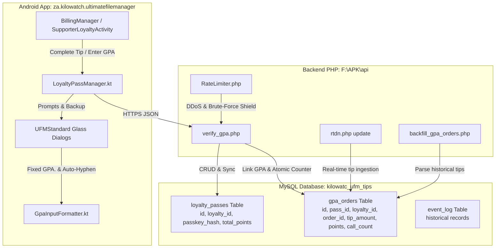

# Implementation Plan: Anonymous Loyalty Pass & GPA Tip Verification System

**Target Environments**:
- Backend PHP APIs: `F:\APK\api\`
- MySQL Database: `kilowatc_ufm_tips`
- Android Application: `za.kilowatch.ultimatefilemanager.billing`

---

## Goal Description
Build an authoritative, privacy-first, central repository for Google Play tip orders (GPA numbers) and loyalty points ($1 = 10 points) that completely replaces device-local `SharedPreferences` point storage. 

This enables supporters to retain, aggregate, and restore their points and unlocked badge tiers across devices and app reinstalls without requiring any personal data (no names, emails, Google accounts, or device identifiers).

---

## User Review Required

> [!IMPORTANT]
> **Zero Personal Data & Anonymous Terminology**:
> In accordance with privacy requirements, the concept of "accounts" has been strictly replaced by **"Loyalty Pass"**, **"Loyalty ID"** (`XXX-XXX-XXX-XXX`), and **"Passkey"**. No personal data is captured or stored anywhere.

> [!NOTE]
> **Historical Backfill**:
> A standalone migration script (`backfill_gpa_orders.php`) will parse all historical tip events from the existing `event_log` table (over 300 records as seen in `sql.PNG`) to populate `gpa_orders` with initial `points = ROUND(tip_amount * 10)`.

---

## Proposed Changes



---

### Component 1: Database Migration Scripts

#### [NEW] `F:\APK\api\schema_loyalty_system.sql`
Creates the two relational tables with strict constraints and indexes:

```sql
-- 1. Anonymous Loyalty Passes Table
CREATE TABLE IF NOT EXISTS `loyalty_passes` (
    `id` BIGINT UNSIGNED NOT NULL AUTO_INCREMENT,
    `loyalty_id` VARCHAR(19) NOT NULL,
    `passkey_hash` VARCHAR(255) NOT NULL,
    `total_points` INT UNSIGNED NOT NULL DEFAULT 0,
    `total_amount_usd` DECIMAL(10, 2) NOT NULL DEFAULT 0.00,
    `failed_attempts` TINYINT UNSIGNED NOT NULL DEFAULT 0,
    `locked_until` DATETIME DEFAULT NULL,
    `created_at` DATETIME NOT NULL DEFAULT CURRENT_TIMESTAMP,
    `updated_at` DATETIME NOT NULL DEFAULT CURRENT_TIMESTAMP ON UPDATE CURRENT_TIMESTAMP,
    PRIMARY KEY (`id`),
    UNIQUE KEY `uq_loyalty_id` (`loyalty_id`),
    KEY `idx_total_points` (`total_points`),
    KEY `idx_created_at` (`created_at`)
) ENGINE=InnoDB DEFAULT CHARSET=utf8mb4 COLLATE=utf8mb4_unicode_ci;

-- 2. GPA Orders Table
CREATE TABLE IF NOT EXISTS `gpa_orders` (
    `id` BIGINT UNSIGNED NOT NULL AUTO_INCREMENT,
    `pass_id` BIGINT UNSIGNED DEFAULT NULL,
    `loyalty_id` VARCHAR(19) DEFAULT NULL,
    `order_id` VARCHAR(64) NOT NULL,
    `product_id` VARCHAR(64) DEFAULT NULL,
    `tip_amount` DECIMAL(10, 2) NOT NULL DEFAULT 0.00,
    `currency` VARCHAR(3) NOT NULL DEFAULT 'USD',
    `points` INT UNSIGNED NOT NULL DEFAULT 0,
    `call_count` INT UNSIGNED NOT NULL DEFAULT 0,
    `last_called_at` DATETIME DEFAULT NULL,
    `claimed_at` DATETIME DEFAULT NULL,
    `created_at` DATETIME NOT NULL DEFAULT CURRENT_TIMESTAMP,
    `updated_at` DATETIME NOT NULL DEFAULT CURRENT_TIMESTAMP ON UPDATE CURRENT_TIMESTAMP,
    PRIMARY KEY (`id`),
    UNIQUE KEY `uq_order_id` (`order_id`),
    KEY `fk_gpa_pass_id` (`pass_id`),
    KEY `idx_loyalty_id` (`loyalty_id`),
    KEY `idx_call_count` (`call_count`),
    KEY `idx_created_at` (`created_at`),
    CONSTRAINT `fk_gpa_orders_pass` 
        FOREIGN KEY (`pass_id`) REFERENCES `loyalty_passes` (`id`) 
        ON DELETE SET NULL ON UPDATE CASCADE
) ENGINE=InnoDB DEFAULT CHARSET=utf8mb4 COLLATE=utf8mb4_unicode_ci;
```

---

### Component 2: Backend Historical Backfill & RTDN Real-Time Ingestion

#### [NEW] `F:\APK\api\backfill_gpa_orders.php`
- Connects via `Database::getInstance()->getConnection()`.
- Queries `event_log` where `message LIKE 'Tip processed:%GPA.%'`.
- Regex extraction: `/Tip processed:\s*\$([0-9.]+)\s*USD\s*\(product:\s*([^,]+),\s*order:\s*(GPA\.\d{4}-\d{4}-\d{4}-\d{5})\)/i`.
- Computes `points = ROUND(amount * 10)`.
- Batch inserts into `gpa_orders` with `ON DUPLICATE KEY UPDATE updated_at = NOW()`.
- Outputs CLI execution report (rows scanned, inserted, skipped).

#### [MODIFY] `F:\APK\api\rtdn.php`
- In step 7d of `rtdn.php` (where tips are processed), add atomic ingestion to `gpa_orders`:
  ```php
  if (!empty($orderId) && preg_match('/^GPA\.\d{4}-\d{4}-\d{4}-\d{5}$/i', $orderId)) {
      $points = (int) round($usdAmount * 10);
      $stmtGpa = $pdo->prepare(
          'INSERT INTO gpa_orders (order_id, product_id, tip_amount, currency, points, call_count, created_at, updated_at)
           VALUES (:order_id, :product_id, :amount, :currency, :points, 0, NOW(), NOW())
           ON DUPLICATE KEY UPDATE
               tip_amount = VALUES(tip_amount),
               points     = VALUES(points),
               product_id = VALUES(product_id),
               updated_at = NOW()'
      );
      $stmtGpa->execute([
          ':order_id'   => strtoupper($orderId),
          ':product_id' => $productId,
          ':amount'     => $usdAmount,
          ':currency'   => 'USD',
          ':points'     => $points,
      ]);
  }
  ```

---

### Component 3: Backend Security & Verification API

#### [NEW] `F:\APK\api\RateLimiter.php`
- File-based sliding window rate limiter:
  - Global IP Limit: 30 requests/minute.
  - Failure/Brute-Force Limit: 5 failed passkey attempts locks the Loyalty ID for 15 minutes.
  - Returns remaining attempts, lockout status, and `Retry-After` headers.

#### [NEW] `F:\APK\api\verify_gpa.php`
Implements the 4 core actions (all case-insensitive for GPA numbers and Loyalty IDs):
- **Case-Insensitive Normalization**:
  All input identifiers are normalized on ingest:
  `$orderId = strtoupper(trim($input['order_id'] ?? ''))`
  `$loyaltyId = strtoupper(trim($input['loyalty_id'] ?? ''))`
- Database collation `utf8mb4_unicode_ci` inherently guarantees case-insensitive comparisons.
1. `check_gpa`:
   - Validates regex `/^GPA\.\d{4}-\d{4}-\d{4}-\d{5}$/i`.
   - Checks if order exists in `gpa_orders`.
   - Returns `{ success: true, status: "unclaimed" }` or `{ success: true, status: "already_claimed", loyalty_id_masked: "B4K-***-***-8R1" }`.
2. `create_pass`:
   - **Guaranteed Unique Loyalty ID Generation**:
     Generates a random `XXX-XXX-XXX-XXX` Loyalty ID using cryptographically secure `random_int`.
     Checks `SELECT 1 FROM loyalty_passes WHERE loyalty_id = :id` in a retry loop (up to 10 attempts) to guarantee that the generated Loyalty ID does **NOT** already exist.
     Enforced by `UNIQUE KEY uq_loyalty_id` at the MySQL engine level with `PDOException` (SQLState 23000) retry handling.
   - Generates 16-character secure random Passkey (`random_bytes`).
   - Hashes with `password_hash($passkey, PASSWORD_BCRYPT, ['cost' => 12])`.
   - Inserts row into `loyalty_passes` and updates `gpa_orders` (`pass_id`, `loyalty_id`, `claimed_at = NOW()`).
   - Returns Loyalty ID, raw Passkey, points, and tip history.
3. `claim_to_existing`:
   - Validates Loyalty ID and verifies `password_verify($passkey, $row['passkey_hash'])`.
   - Attaches unclaimed GPA to the Loyalty Pass.
   - Recalculates `total_points = SUM(points)` in `gpa_orders` and updates `loyalty_passes`.
   - Returns all tips and updated total points.
4. `restore`:
   - Resolves Loyalty ID (from direct ID or previous GPA lookup, case-insensitively).
   - Verifies passkey.
   - Returns full tip history and cumulative points for local delta sync.

---

### Component 4: Android Client Integration (UFM Pro)

#### [NEW] `app/src/main/java/za/kilowatch/ultimatefilemanager/billing/GpaInputFormatter.kt`
- **Fixed `GPA.` Prefix**:
  - Attached via `TextInputLayout.prefixText = "GPA."` with distinct accent styling.
  - Non-editable: User cannot backspace or erase the prefix.
- **Smart Auto-Hyphen Formatter (`TextWatcher`)**:
  - Automatically formats raw digits as the user types into:
    `XXXX-XXXX-XXXX-XXXXX` (4 digits, hyphen, 4 digits, hyphen, 4 digits, hyphen, 5 digits).
  - Handles backspacing smoothly without cursor jumping or getting trapped on hyphens.
  - **Paste-Aware Sanitization**:
    If a user pastes from their email receipt (e.g., `GPA.3398-3263-8701-36162`, `gpa.33983263870136162`, or `3398-3263-8701-36162`), it automatically strips any leading `GPA.` or `gpa.`, extracts the 17 digits, and applies the hyphen format automatically.
- **Case-Insensitive Loyalty ID Formatter**:
  - Automatically converts all characters to uppercase as typed.
  - Automatically inserts hyphens for `XXX-XXX-XXX-XXX` format.

#### [NEW] `app/src/main/java/za/kilowatch/ultimatefilemanager/billing/LoyaltyPassManager.kt`
- Manages local storage of `active_loyalty_id` and passkey in encrypted shared preferences.
- Performs async network calls to `verify_gpa.php` using standard `HttpURLConnection` / coroutines.
- Computes delta sync: receives full tip list from server, checks local database, inserts missing entries, and synchronizes `total_points`.
- Exposes `claimGpaOrder(gpa, callback)`, `restorePass(identifier, passkey, callback)`, and `syncPass(callback)`.

#### [NEW] Layouts for UFMStandard Dialogs:
All dialogs strictly adhere to **UFMStandard Dialog Architecture**:
- Root layout: `@drawable/bg_dialog_glass`, `24dp` padding, transparent dialog window (`ColorDrawable(Color.TRANSPARENT)`).
- Header: Centered 56×56dp frosted squircle icon (`@drawable/bg_btn_icon_frosted`) with 28×28dp themed vector icon.
- Typography: 20sp `sans-serif-black` title (`@color/mobile_text_primary`) and 13sp `sans-serif-medium` subtitle (`@color/mobile_text_secondary`).
- Content Cards: `@color/mobile_glass_card` with `@color/mobile_glass_stroke` (1dp stroke, 16dp corner radius).
- Vertical Button Stack:
  - Primary: `@style/Widget.Material3Expressive.Button`, 48dp height, 12dp corner radius, bold text, `?attr/colorPrimary`.
  - Secondary/Dismiss: `@style/Widget.Material3.Button.TextButton` or TonalButton, 48dp height, 12dp corner radius.

Files to implement:
- `dialog_unclaimed_tip_prompt.xml`: Notifies of unclaimed tip and asks if the user already has a Loyalty ID.
- `dialog_loyalty_pass_credentials.xml`: Displays newly generated Loyalty ID and Passkey with "Copy to Clipboard", "I Have Saved My Passkey", and the 100% Anonymous disclosure.
- `dialog_loyalty_pass_restore.xml`: Input for Loyalty ID / previous GPA and Passkey to restore points on a clean install. Uses `GpaInputFormatter` for fixed `GPA.` prefix and auto-hyphenation.
- `dialog_claim_past_gpa.xml`: Input dialog for existing supporters to paste historical GPA order numbers. Uses `GpaInputFormatter` for fixed `GPA.` prefix and auto-hyphenation.

#### [MODIFY] `app/src/google/java/za/kilowatch/ultimatefilemanager/billing/SupporterLoyaltyActivity.kt`
- Adds a **Loyalty Pass Card** in the UI:
  - If no pass active: Shows "Anonymous Loyalty Pass • Tap to Restore or Create" and "Claim Past Tip".
  - If pass active: Displays masked Loyalty ID (`B4K-***-***-8R1`), points total, "View / Backup Pass", and "Claim Past Tip".
- On billing completion (`onPurchaseSuccess`), automatically queries `check_gpa` to guide the user into auto-attach or the decision modal.
- Integrates `BadgeIconManager.getTotalTippedPoints` with `LoyaltyPassManager` verified points.

---

## Verification Plan

### Automated Tests
1. **PHP Syntax & Linter Verification**:
   ```powershell
   php -l F:\APK\api\schema_loyalty_system.sql
   php -l F:\APK\api\RateLimiter.php
   php -l F:\APK\api\verify_gpa.php
   php -l F:\APK\api\backfill_gpa_orders.php
   php -l F:\APK\api\rtdn.php
   ```
2. **Android Compilation & Dex Verification**:
   ```powershell
   ./gradlew compileMobileGoogleDebugKotlin
   ./gradlew assembleMobileGoogleDebug
   ```

### Manual Verification
1. **Backfill Execution**: Run `backfill_gpa_orders.php` and verify rows are populated in `gpa_orders` from `event_log` with correct points ($1 = 10 pts).
2. **API Verification via cURL / PowerShell**:
   - `check_gpa`: Test valid GPA returns `unclaimed`.
   - `create_pass`: Verify new Loyalty ID + Passkey generation and database link.
   - `claim_to_existing`: Verify second GPA merges into the same Loyalty ID and combines points.
   - `restore`: Verify entering GPA + Passkey restores the full tip list.
   - Brute-force test: 5 bad passkeys trigger HTTP 423 lockout.
3. **App UI Walkthrough**:
   - Verify fixed `GPA.` prefix and auto-hyphen formatting when typing or pasting.
   - Test "Claim Past Tip" in "Fuel the Developer" on mobile device.
   - Verify UFMStandard glass dialogs and credentials clipboard copying.
