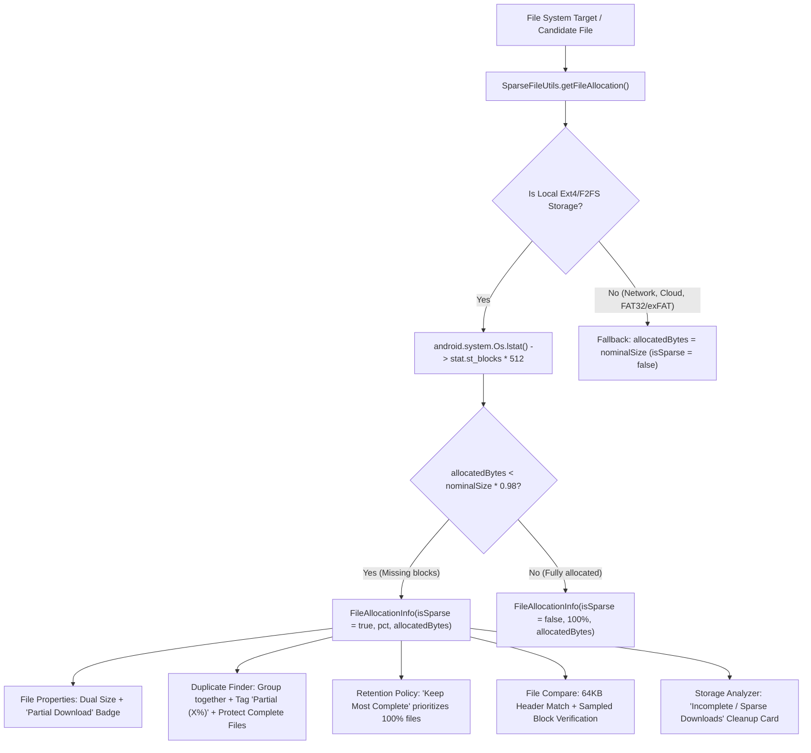

# Implementation Plan: Actual vs. Nominal File Size Detection & Sparse/Incomplete File Handling

## Goals
Enable Ultimate File Manager to identify, display, and intelligently handle sparse and pre-allocated incomplete files (such as incomplete torrent downloads and sparse disk images) across the application. Specifically:
- Expose both **Nominal (Logical) Size** and **Actual Allocated Disk Usage** in File Properties.
- Differentiate between complete and partial downloads in the **Duplicate Finder**, displaying allocation badges and protecting complete files from accidental deletion.
- Add an explicit **"Keep Most Complete"** duplicate retention policy preset.
- Enhance **File Comparison** (`FileCompareDialogFragment`) to perform fast header (64 KB) and sampled block verification, reporting partial matches when nominal sizes match but hashes differ.
- Add an **"Incomplete / Sparse Downloads"** cleanup recommendation card to **Storage Analyzer**.
- Provide graceful degradation for cloud, network, and storage volumes where physical block allocation is unsupported.

---

## Architecture Overview

### Architectural Decisions

1. **Strict Adherence to UFMStandard Dialogs & Styling**:
   - All dialogs and bottom sheets (`FilePropertiesBottomSheet`, `FileCompareDialogFragment`, and any cleanup prompts) strictly adhere to **UFMStandard**:
     - Dark frosted glassmorphic theme styling (`@drawable/bg_dialog_glass`, `@drawable/bg_card_frosted`, `@drawable/bg_btn_icon_frosted`).
     - Dual-layout architecture for Mobile (`dialog_<name>.xml` / bottom sheet) and Android TV (`dialog_<name>_tv.xml` / 10-foot centered dialog).
     - Android TV remote D-pad navigation with yellow focus highlights (`@drawable/selector_btn_glass_yellow` / `selector_card_glass_tv`).
     - Standard action button hierarchy (primary action stacked above secondary/dismiss).
     - Any user alert or confirmation prompts route through `UfmDialogHelper` for consistent UFMStandard glass rendering.

2. **Lightweight POSIX Block Inspection (`SparseFileUtils`)**:
   - Uses `android.system.Os.lstat(file.absolutePath)` via Android's Bionic C library binding.
   - Calculates allocated bytes as `stat.st_blocks * 512L`.
   - Compares against `stat.st_size` (nominal logical length).
   - If `nominalSize > 64 KB` and `allocatedBytes < nominalSize * 0.98L` (or difference > 4096 bytes), the file is classified as sparse/partially allocated.
   - For files on network protocols (SMB, SFTP, WebDAV, Cloud) or filesystems without block allocation support, `SparseFileUtils` falls back gracefully without errors or false positives.

2. **File Properties Dual Display (`FilePropertiesBottomSheet`)**:
   - If a file is sparse, `FilePropertiesBottomSheet` displays both the nominal size and physical size on disk:
     - `Size: 4.50 GB (4,831,838,208 bytes)`
     - `Size on disk: 350.00 MB (367,001,600 bytes) — 7.2% allocated`
     - Displays an amber warning chip/badge: `Partial Download (Sparse)`.

3. **Duplicate Finder Protection & Retention (`DuplicateRetentionManager` & `AnalyzerDuplicateAdapter`)**:
   - In `AnalyzerDuplicateAdapter`, sparse files in a duplicate group display an amber badge: `Partial (X%)`.
   - In automated retention selection (`KEEP_OLDEST`, `KEEP_NEWEST`), complete files are **always protected** from deletion over partial files. An incomplete file will never be chosen as the "keeper" when a 100% complete file exists in the same group.
   - Add a new retention preset `KEEP_MOST_COMPLETE` (`mode = "most_complete"`), sorting by allocation percentage descending before applying timestamp tie-breakers.

4. **File Comparison Header & Offset Matching (`FileCompareDialogFragment`)**:
   - When comparing two files that have matching nominal sizes:
     - If both files have identical nominal sizes but differ in allocated blocks or standard full-hash:
     - Read the initial 64 KB header of both files.
     - If headers match, sample non-zero data offsets from the partial file against the reference file.
     - If matched, display a dedicated status: `Matching Header / Partial Copy (X% allocated vs Y% allocated)`.

5. **Storage Analyzer Cleanup Recommendation**:
   - In `StorageAnalyzerEngine`, scan indexed files for sparse downloads (`isSparse == true`).
   - Emit a dedicated `CleanupRecommendation`:
     - Title: `Incomplete / Sparse Downloads`
     - Description: `Found X partially downloaded files wasting Y MB on disk`
     - Risk level: `RiskLevel.MODERATE`

---

## Files to Create

### `app/src/main/java/za/kilowatch/ultimatefilemanager/util/SparseFileUtils.kt` — Core Utility
- **What:** Provides POSIX-level block inspection, sparse allocation detection, and partial file comparison.
- **Key Details:**
  - `data class FileAllocation(val nominalSize: Long, val allocatedBytes: Long, val isSparse: Boolean, val allocationPercentage: Float)`
  - `fun getFileAllocation(file: File): FileAllocation`
  - `fun isSparseFile(file: File): Boolean`
  - `sealed class PartialCompareResult { object MatchFull, data class MatchPartial(val pctA: Float, val pctB: Float), object HeaderMismatch, object SizeMismatch }`
  - `fun comparePartialFiles(fileA: File, fileB: File): PartialCompareResult`

### `app/src/test/java/za/kilowatch/ultimatefilemanager/util/SparseFileUtilsTest.kt` — Unit Tests
- **What:** Unit tests for allocation math, percentage calculation, threshold logic, and partial header comparisons.

---

## Files to Modify

### `app/src/main/res/layout/dialog_file_properties.xml` — File Properties Layout
- **What:** Add `rowSizeOnDisk` (TableRow) with `txtSizeOnDiskLabel`, `txtSizeOnDiskValue`, and `badgeSparseWarning` immediately beneath `rowSize`.

### `app/src/main/java/za/kilowatch/ultimatefilemanager/storage/FilePropertiesBottomSheet.kt` — File Properties Logic
- **What:** Bind `rowSizeOnDisk` and evaluate `SparseFileUtils.getFileAllocation()`. Display actual size, allocated percentage, and sparse warning badge when `isSparse == true`.

### `app/src/main/java/za/kilowatch/ultimatefilemanager/storage/DuplicateRetentionManager.kt` — Retention Policies
- **What:**
  - Add `MODE_MOST_COMPLETE = "most_complete"`
  - Add `KEEP_MOST_COMPLETE` to `DuplicateRetentionPolicy` enum
  - Update `fromKey()` to parse `MODE_MOST_COMPLETE`

### `app/src/main/java/za/kilowatch/ultimatefilemanager/storage/AnalyzerDuplicateAdapter.kt` — Duplicate List UI & Selection
- **What:**
  - Update `selectAllDuplicates()`:
    - Enforce protection of complete files (a complete file is never selected for deletion if a duplicate candidate is a partial download).
    - Handle `DuplicateRetentionPolicy.KEEP_MOST_COMPLETE`.
  - In `FileVH`: check if file is sparse. If sparse, display `txtDupSparseBadge` (`Partial (X%)`) and format `txtDupFileSize` with dual size.

### `app/src/main/res/layout/item_analyzer_duplicate_file.xml` & `item_analyzer_duplicate_file_tv.xml` — Duplicate Item Layouts
- **What:** Add `txtDupSparseBadge` TextView with amber warning background (`bg_badge_sparse`) next to `txtDupPreservedBadge`.

### `app/src/main/java/za/kilowatch/ultimatefilemanager/checksum/FileCompareDialogFragment.kt` — File Comparison
- **What:**
  - Detect sparse files for local comparison targets.
  - When nominal sizes match, invoke `SparseFileUtils.comparePartialFiles()`.
  - Display partial match banner and allocation status when a complete and incomplete copy are compared.

### `app/src/main/java/za/kilowatch/ultimatefilemanager/storage/StorageAnalyzerEngine.kt` — Storage Analyzer
- **What:**
  - Add `getIncompleteDownloads(storageId: String): List<FileIndex>`
  - Emit an `Incomplete / Sparse Downloads` recommendation in `buildRecommendations()`.

### `app/src/main/res/values/strings.xml` — English String Resources
- **What:** Add strings for:
  - `properties_label_size_on_disk`: `"Size on disk"`
  - `properties_sparse_badge`: `"Partial Download (Sparse)"`
  - `properties_sparse_allocated_pct`: `"%1$s (%2$.1f%% allocated)"`
  - `duplicate_badge_partial`: `"Partial (%1$.0f%%)"`
  - `retention_keep_most_complete`: `"Keep Most Complete"`
  - `compare_result_partial_match`: `"Matching Header & Data — Incomplete Download (%1$.1f%% allocated)"`
  - `analyzer_incomplete_downloads_title`: `"Incomplete / Sparse Downloads"`
  - `analyzer_incomplete_downloads_desc`: `"Found %1$d incomplete or sparse files consuming disk space"`

---

## Data Model Changes
- No SQLite database schema changes required. `FileIndex` already tracks file path and nominal size. POSIX block queries are performed on candidate files on-demand during detailed inspections and duplicate resolution.

---

## Verification Plan

### Automated Tests
1. **`SparseFileUtilsTest`**:
   - Run via `./gradlew testMobileGoogleDebugUnitTest --tests "za.kilowatch.ultimatefilemanager.util.SparseFileUtilsTest"`
   - Verifies allocation calculation, percentage clamping, and threshold logic.
2. **`DuplicateRetentionTest`**:
   - Run via `./gradlew testMobileGoogleDebugUnitTest --tests "za.kilowatch.ultimatefilemanager.storage.DuplicateRetentionTest"`
   - Verifies `KEEP_MOST_COMPLETE` policy and complete file protection under `KEEP_OLDEST` and `KEEP_NEWEST`.

### Manual Verification
1. **File Properties**:
   - Inspect a complete local file: Verify standard single size line is shown.
   - Inspect a partially downloaded torrent file: Verify `Size on disk` and `Partial Download` badge appear with correct percentage.
2. **Duplicate Finder**:
   - Run duplicate finder on a folder containing a complete file and a partial torrent download with the same nominal size.
   - Verify the partial file is badged `Partial (X%)`.
   - Verify `Select All Duplicates` marks the partial file for deletion while keeping the complete file preserved.
3. **File Compare**:
   - Select both the complete file and the partial download in Twin Window mode and choose **Compare**.
   - Verify the dialog shows `Matching Header / Partial Copy (X% allocated)` instead of a generic hash failure.
4. **Storage Analyzer**:
   - Open Storage Analyzer: Verify the `Incomplete / Sparse Downloads` card appears in Suggestions if incomplete files exist on device.
