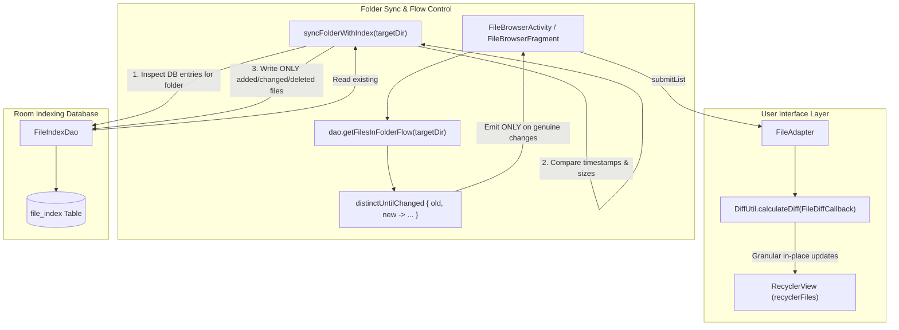

# Implementation Plan: Folder File List Stability & Background Sync Optimization

## Goals
Eliminate the bug described in `error.txt` where opening a folder causes the file list to become laggy and autonomously jump/scroll up and down without user interaction.
- Ensure the file list remains 100% stationary when untouched.
- Replace disruptive `notifyDataSetChanged()` with granular `DiffUtil` calculations in `FileAdapter`.
- Optimize `childCountJob` to use targeted metadata payloads (`notifyItemChanged(pos, PAYLOAD_METADATA)`).
- Prevent redundant SQLite/Room invalidation loops by adding smart diff checks before database writes in `syncFolderWithIndex`.
- Deduplicate Room Flow emissions using `distinctUntilChanged` on folder file lists.
- Maintain TV focus strictly on the currently selected item without synthetic focus jumps or unwanted re-scrolling.

---

## Architecture Overview

### Architectural Decisions & Root Cause Resolution
1. **Root Cause 1 — Unconditional Database Writes in `syncFolderWithIndex`**:
   Whenever a folder was loaded, `syncFolderWithIndex(directory)` unconditionally called `dao.insertAll(fileIndices)`. This triggered Room's `InvalidationTracker` for the entire `file_index` table, which immediately triggered `dao.getFilesInFolderFlow(directory)` again.
   *Resolution*: Perform a smart pre-flight diff against `dao.getFilesInFolder(directory.absolutePath)` before writing. If all physical files match the database snapshot in path, size, and lastModified timestamp, **skip database writes entirely** (0 SQLite writes, 0 table invalidations).
2. **Root Cause 2 — Room Table-Level Flow Invalidation Loop**:
   Room queries emit whenever the underlying table is written to, even if the result of `WHERE folderPath = :folderPath` is identical. When startup reconcile or background indexing touched *any* file on the device, every open folder's Flow emitted.
   *Resolution*: Add `.distinctUntilChanged { old, new -> ... }` comparing item paths, sizes, timestamps, and directory flags. Identical list emissions are dropped immediately before reaching the Main thread.
3. **Root Cause 3 — Disruptive Full List Clears & `notifyDataSetChanged()` in `FileAdapter`**:
   `FileAdapter.submitList` called `items.clear(); items.addAll(); notifyDataSetChanged()`. This reset the `RecyclerView` view holder cache and scroll position to 0, which fought with asynchronous `post { scrollToPositionWithOffset(...) }` calls, resulting in visible vertical jitter and layout thrashing.
   *Resolution*:
   - Early return `if (oldItems == newItems) return` when data has not changed.
   - Use `DiffUtil.calculateDiff(FileDiffCallback(oldItems, newItems))` to compute surgical item insertions, removals, moves, and payload updates.
   - Dispatch updates natively to the adapter via `diffResult.dispatchUpdatesTo(this)`.
4. **Root Cause 4 — Child Count and Folder Size Calculation Invalidation**:
   `childCountJob` computed directory child counts and sizes asynchronously, and when finished, called `notifyDataSetChanged()`, causing another full layout re-bind and jitter.
   *Resolution*: Update only directory rows using `notifyItemChanged(position, PAYLOAD_METADATA)` and bind metadata in `onBindViewHolder(holder, position, payloads)`. Non-directory rows and view holders remain completely untouched.
5. **Root Cause 5 — Redundant Asynchronous Scroll Overriding**:
   In `submitAdapterList`, `recyclerFiles.post { scrollToPositionWithOffset(...) }` was called on same-folder updates. With `DiffUtil`, RecyclerView natively preserves scroll position. We remove the synthetic scroll post on same-folder updates, eliminating the bounce.

---

## Files to Modify

### `app/src/main/java/za/kilowatch/ultimatefilemanager/storage/FileAdapter.kt`
- **What**:
  - Implement `FileDiffCallback` extending `DiffUtil.Callback` comparing `ListItem.FileEntry`, `ListItem.Header`, and `ListItem.EmptyBuffer`.
  - Add `PAYLOAD_METADATA = "payload_metadata"` and `PAYLOAD_SELECTION = "payload_selection"`.
  - Update `submitList` to early-return on identical content and use `DiffUtil.calculateDiff` instead of `notifyDataSetChanged()`.
  - Refactor `childCountJob` to dispatch granular `notifyItemChanged(pos, PAYLOAD_METADATA)` only for affected directory items.
  - Implement `onBindViewHolder(holder: RecyclerView.ViewHolder, position: Int, payloads: List<Any>)` to update only `txtSubtitle` when `PAYLOAD_METADATA` is received.

### `app/src/main/java/za/kilowatch/ultimatefilemanager/storage/FileBrowserActivity.kt`
- **What**:
  - In `loadDirectory`:
    - Add `.distinctUntilChanged` to `dao.getFilesInFolderFlow(targetDir.absolutePath)`.
  - In `syncFolderWithIndex`:
    - Query `existingInDb = dao.getFilesInFolder(directory.absolutePath)` before writing.
    - Compare `actualFiles` against `existingInDb` by `path`, `size`, `lastModified`, and `isDirectory`.
    - Only insert new/modified files (`toInsertOrUpdate`) and delete stale paths (`stalePaths`) if non-empty.
  - In `submitAdapterList`:
    - Only perform scroll restoration when navigating between different directories (`isNavigatingFolder`).
    - Remove redundant same-folder `scrollToPositionWithOffset` post-calls, letting `DiffUtil` retain viewport stability natively.

### `app/src/main/java/za/kilowatch/ultimatefilemanager/storage/FileBrowserFragment.kt`
- **What**:
  - Apply the exact same optimizations to `FileBrowserFragment` to guarantee identical stability across Tabbed Browser and Twin Window Mode:
    - Add `.distinctUntilChanged` to `dao.getFilesInFolderFlow`.
    - Apply smart diff in `syncFolderWithIndex` before database writes.
    - Remove redundant same-folder scroll posts in `submitAdapterList`.

---

## Files to Create

### `app/src/test/java/za/kilowatch/ultimatefilemanager/storage/FileDiffCallbackTest.kt`
- **What**: Unit test for `FileDiffCallback` and smart folder synchronization diff logic.
- **Key details**: Tests that identical lists produce empty diffs, additions/removals/modifications produce exact changes, and metadata payloads are generated correctly.

---

## Data Model
No changes to SQLite database schema or entity definitions. Existing `FileIndex` and `file_index` table structure remain unchanged.

---

## Dependencies
No new third-party dependencies required. Uses standard Android Jetpack `androidx.recyclerview.widget.DiffUtil` and Kotlin Coroutines Flow `distinctUntilChanged`.

---

## Test Plan
1. **Automated Unit Tests**:
   - Run `./gradlew testMobileGoogleDebugUnitTest --tests "za.kilowatch.ultimatefilemanager.storage.FileDiffCallbackTest"`.
   - Run full unit test suite to verify no regressions: `./gradlew testMobileGoogleDebugUnitTest`.
2. **Build Verification**:
   - Compile debug build: `./gradlew assembleMobileGoogleDebug`.
3. **Manual Verification**:
   - Open the app, navigate into a folder with mixed files and subdirectories.
   - Wait 10 seconds without touching the screen. Verify the list remains 100% stationary with zero autonomous movement or twitching.
   - Verify folder sizes and item counts populate cleanly in-place.
   - Verify scrolling is smooth at 60/120 fps.
   - Verify on Android TV that focus stays locked on the selected item without bouncing.

---

## Risks & Mitigations
- **Risk**: DiffUtil calculation on very large directories (e.g. 5,000+ items) taking too long on the main thread.
  - **Mitigation**: Add an early-return check `if (oldItems == newItems) return` to avoid running DiffUtil when nothing changed. For lists $\ge 1,000$ items, DiffUtil runs quickly on lightweight `ListItem` references, but we can also dispatch calculation via background dispatcher if needed.
- **Risk**: Stale selection state when items are modified.
  - **Mitigation**: `FileDiffCallback` includes selection state in `areContentsTheSame` and provides `PAYLOAD_SELECTION` so selected items update accurately without list jumps.
