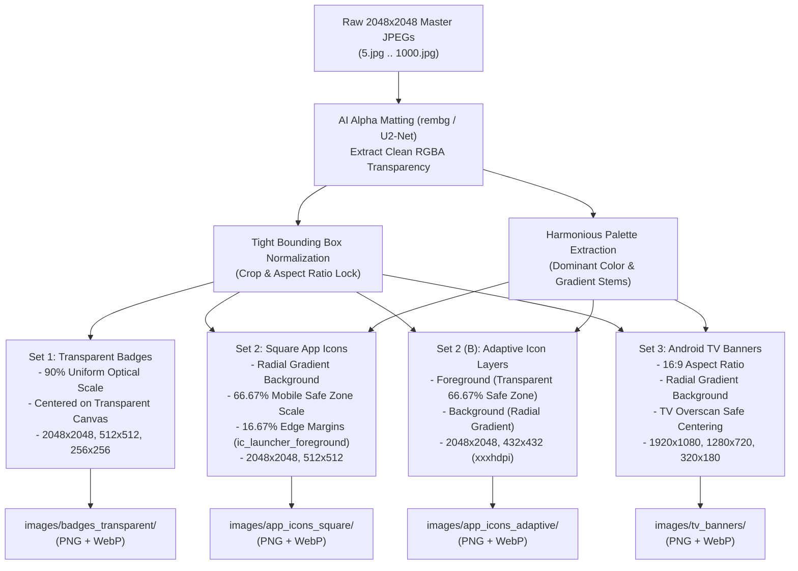

# Implementation Plan: High-Quality Badge & Custom App Icon Asset Pipeline

## Goals
Implement an automated, high-precision image processing pipeline to transform the 10 raw milestone renders (`images/5.jpg` through `images/1000.jpg`) into three production-ready asset suites organized into dedicated folders under `images/`:
1. **Set 1: In-App Transparent Badges** (`images/badges_transparent/`): 2048×2048, 512×512, and 256×256 transparent PNG & WebP assets with normalized optical scale (~90%).
2. **Set 2: Square App Icons** (`images/app_icons_square/`): 2048×2048 and 512×512 PNG & WebP square icons with a matching radial gradient background and the exact mobile launcher safe-zone padding (66.67% emblem scale, 16.67% edge margins).
3. **Set 2 (B): Adaptive Icon Layers** (`images/app_icons_adaptive/`): Separate foreground (emblem with 16.67% margin on transparent canvas) and matching background layers at 2048×2048 and 432×432 (xxxhdpi).
4. **Set 3: Android TV Leanback Banners** (`images/tv_banners/`): 16:9 widescreen banners at 1920×1080, 1280×720, and 320×180 (PNG & WebP) with centered emblem and overscan protection.

---

## Architecture Overview



### Key Technical Decisions
1. **Neural Alpha Matting**: Uses `rembg` (U2-Net ONNX engine) for background extraction, followed by alpha border cleanup to prevent single-pixel dark boundary halos.
2. **Deterministic Palette Computation**: Computes the dominant primary hue using k-means/histogram clustering on visible emblem pixels (alpha > 128), generating a paired radial gradient:
   - Inner highlight: slightly desaturated and brightened (+15% luminance) for a gentle rim spotlight behind the emblem.
   - Outer rim: deep shade (35–45% luminance) for contrast and depth.
3. **Exact Launcher Geometry Matching**: Conforms directly to UFM's mobile launcher standard:
   - Canvas: Square.
   - Safe Zone: Exactly `(w * 2/3, h * 2/3)`.
   - Edge Padding: Exactly `(w * 1/6, h * 1/6)`.
   - Guaranteed immunity against masking cutoffs on circular (50% radius), squircle, or pebble launcher shapes.
4. **Leanback TV 16:9 Standard**: 
   - Banner aspect ratio: exactly 16:9 (`1920×1080` master, `1280×720` xxxhdpi, `320×180` baseline).
   - Emblem height: ~72% of banner height with centered alignment, providing ample overscan buffer.
5. **Dual Format Generation**: Outputs both master 32-bit lossless PNG and modern high-quality WebP (`quality=95`, method=6) for instant, lightweight deployment.

---

## Files to Create

### `scripts/process_badges.py` — Automated Pipeline Script
- **What**: End-to-end Python script that loads raw images from `images/`, applies background removal, calculates bounding boxes, extracts color gradients, generates Set 1, Set 2, Set 2 (B), and Set 3, and saves both PNG and WebP files.
- **Key Modules**:
  - `remove_backgrounds()`: Executes `rembg` session, returns clean RGBA `Image`.
  - `extract_palette()`: Analyzes emblem pixels to yield inner and outer gradient RGB tuples.
  - `render_radial_gradient(width, height, inner_color, outer_color)`: Generates high-fidelity smooth 2D radial gradient canvas using NumPy.
  - `build_transparent_badge(emblem, size)`: Centers and scales emblem to 90% canvas dimension.
  - `build_square_app_icon(emblem, size, inner_color, outer_color)`: Centers and scales emblem to 66.67% safe zone over radial gradient.
  - `build_adaptive_layers(emblem, size, inner_color, outer_color)`: Generates separate foreground and background images.
  - `build_tv_banner(emblem, width, height, inner_color, outer_color)`: Generates 16:9 banner with centered emblem.
  - `save_dual_format(image, base_path)`: Exports both `.png` and `.webp`.

---

## Output Directory Structure
```
images/
├── 5.jpg ... 1000.jpg                    (Raw original inputs)
├── badges_transparent/                   (Set 1: In-App Badges)
│   ├── badge_points_5.png / .webp
│   ├── ...
│   ├── badge_points_1000.png / .webp
│   ├── 512/                              (512x512 variants)
│   └── 256/                              (256x256 variants)
├── app_icons_square/                     (Set 2: Square App Icons)
│   ├── app_icon_points_5.png / .webp     (2048x2048 master)
│   ├── ...
│   ├── app_icon_points_1000.png / .webp
│   └── 512/                              (512x512 Play Store standard)
├── app_icons_adaptive/                   (Set 2 B: Adaptive Layers)
│   ├── foreground/
│   │   ├── ic_launcher_points_5_foreground.png / .webp (2048x2048)
│   │   └── 432/                          (432x432 xxxhdpi standard)
│   └── background/
│       ├── ic_launcher_points_5_background.png / .webp (2048x2048)
│       └── 432/                          (432x432 xxxhdpi standard)
└── tv_banners/                           (Set 3: Android TV Leanback Banners)
    ├── tv_banner_points_5.png / .webp    (1920x1080 Full HD master)
    ├── ...
    ├── tv_banner_points_1000.png / .webp
    ├── 1280/                             (1280x720 HD xxxhdpi)
    └── 320/                              (320x180 Leanback baseline)
```

---

## Files to Modify
None in this phase (as confirmed in clarifications, all asset generation is isolated to `images/` subdirectories).

---

## Data Model & Points Mapping
```python
TIERS = [
    {"points": 5, "file": "5.jpg"},
    {"points": 10, "file": "10.jpg"},
    {"points": 20, "file": "20.jpg"},
    {"points": 50, "file": "50.jpg"},
    {"points": 100, "file": "100.jpg"},
    {"points": 200, "file": "200.jpg"},
    {"points": 300, "file": "300.jpg"},
    {"points": 500, "file": "500.jpg"},
    {"points": 750, "file": "750.jpg"},
    {"points": 1000, "file": "1000.jpg"},
]
```

---

## Dependencies
- `Pillow` (PIL) >= 10.0: Image resampling (LANCZOS), RGBA composite, WebP encoding.
- `rembg` >= 2.0: AI background removal using U2-Net ONNX runtime.
- `numpy` >= 1.24: Fast vector array computations for radial gradient rendering and bounding-box alpha masks.

---

## Test & Verification Plan

### Automated Verification Script (`scripts/verify_badges.py`)
- **Dimension Check**: Asserts exact pixel dimensions for all generated PNG and WebP files across all size variants.
- **Alpha Purity Check**: Asserts corner pixels on `badges_transparent/` and adaptive foregrounds are strictly transparent `(0, 0, 0, 0)`.
- **Safe-Zone Bound Check**: Asserts that no non-zero alpha pixel in `app_icons_square` or adaptive foregrounds exceeds the 66.67% safe boundary (left/top >= 16.67%, right/bottom <= 83.33%).
- **File Integrity & Non-Zero Size**: Verifies all generated files exist, are valid readable images, and non-empty.

### Visual Inspection
- Simulate Android launcher circular mask on Set 2 icons to confirm zero edge clipping.
- Verify color contrast and smoothness of radial gradients.

---

## Phase 2: "Fuel the Developer" Badges Section & Dynamic Launcher Icon (Google Mobile Only)

### Goals
Expose the milestone badges in an interactive, prominent "Badges" section within the "Fuel the Developer" tip screen (`SupporterLoyaltyActivity.kt`) exclusively on Google Mobile (`mobileGoogle` flavor, `!isTv`), enabling users to choose any badge and have their Android home screen app icon update dynamically.

### Architecture & Components
1. **Prominent UI Presentation**:
   - `cardBadgesSection`: In `activity_supporter_loyalty.xml`, hidden by default; revealed only on Google Mobile.
   - Header with active badge preview showcase (`imgActiveBadgeHeader`).
   - `item_supporter_badge.xml`: Large 76×76 dp elevated cards with rounded corners displaying the full radial gradient badge from `app_icons_square` alongside the transparent cutout badge accent, points metric, and active selection indicator.
   - 10 badges listed vertically in ascending order (5 to 1,000 points), plus a "Default App Icon" restoration option.
2. **Dynamic Launcher Icon Switching**:
   - 10 `<activity-alias>` declarations in `app/src/google/AndroidManifest.xml` targeting `.onboarding.LanguageWelcomeActivity`.
   - `BadgeIconManager.kt`: Controls `PackageManager.setComponentEnabledSetting(..., DONT_KILL_APP)` to activate the chosen alias and disable the default/other aliases.
   - Persists selected tier in `SharedPreferences` (`ufm_badge_prefs`).
3. **Adaptive Icon Resource Packaging**:
   - Density buckets (`mipmap-mdpi` through `mipmap-xxxhdpi`) installed in `app/src/google/res/`.
   - `mipmap-anydpi-v26/ic_launcher_points_{pts}.xml` combining cutout foreground and matching gradient background.
   - High-res 512px WebP previews in `app/src/google/res/drawable-nodpi/`.

