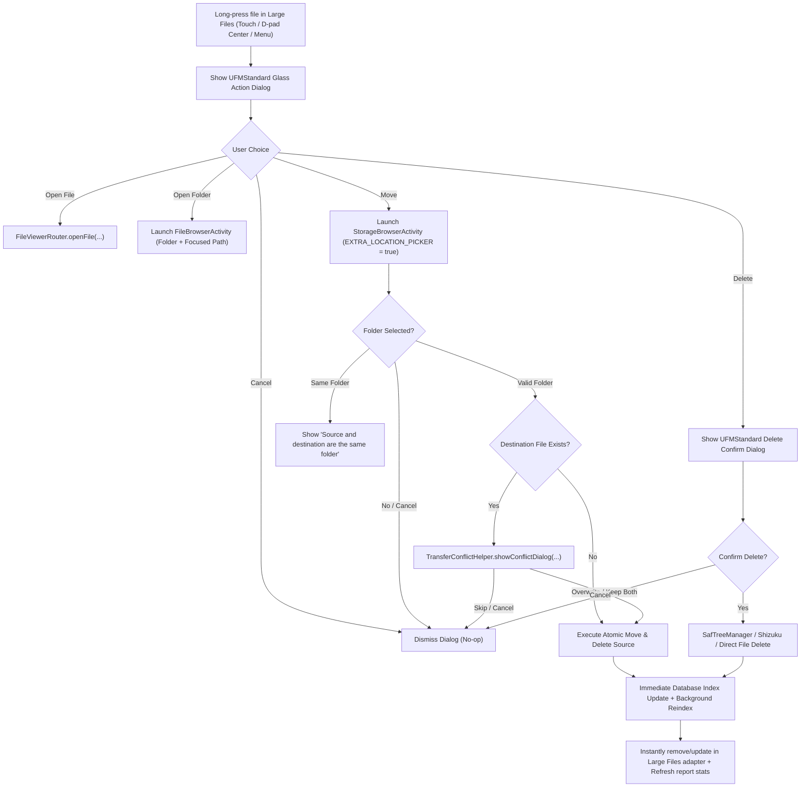

# Implementation Plan: Storage Analyzer – Large Files Action Menu (Move, Delete, Open, Open Folder Location) with Auto-Reindex

## Goal Description
Enhance the Large Files tab in Storage Analyzer so users can long-press (or use D-pad Center / remote Menu on Android TV) on any large file entry to access a UFMStandard contextual glass action menu. The menu provides four actions:
1. **Open File**: Directly view/open the file using UFM built-in viewers or the system default app.
2. **Open Folder Location**: Navigate to the parent directory in `FileBrowserActivity` with the file focused.
3. **Move**: Relocate the file across any accessible storage volume using the UFM Folder Picker (with `EXTRA_LOCATION_PICKER`, feature tiles suppressed, and `TransferConflictHelper` collision detection).
4. **Delete**: Safely delete the file with a UFMStandard glass confirmation dialog showing file name, size, and danger warning.

Following a Move or Delete operation, the system automatically removes/updates the file in the `IndexingRepository` database, reindexes affected directories in the background, and immediately updates the Large Files list and analyzer metrics in real time.

---

## User Review Required

> [!IMPORTANT]
> **Folder Picker Scope**: Per clarification **Q3**, users may move files across different physical volumes (e.g., from internal storage to an external SD Card or USB drive). This cross-storage move will be executed via `TransferConflictHelper.copyLocalToLocalAtomic` followed by verified deletion of the source file.

> [!IMPORTANT]
> **Conflict Resolution**: Per clarification **Q4**, name collisions at the target directory will be intercepted by `TransferConflictHelper`, displaying the standard conflict dialog offering **Overwrite**, **Skip**, **Keep Both (Auto-rename)**, or **Cancel**.

> [!NOTE]
> **UFMStandard Compliance**: All new dialogs adhere strictly to UFMStandard:
> - Container: `android:background="@drawable/bg_dialog_glass"`
> - Transparent window: `dialog.window?.setBackgroundDrawable(ColorDrawable(Color.TRANSPARENT))`
> - TV adaptation: Centered 650dp width, D-pad focus traversal, and TV-compliant button/card selectors.

---

## Architecture & Workflows

### 1. Contextual Action Menu Flow


---

## Proposed Changes

### Component 1: Contextual Action Dialog Layouts

#### [NEW] `dialog_analyzer_large_file_actions.xml`
- Mobile glass dialog layout matching `dialog_search_file_actions.xml`.
- Frosted glass container (`@drawable/bg_dialog_glass`), 20dp padding.
- Header: 44dp frosted icon container (`@drawable/bg_btn_icon_frosted`), file name (`sans-serif-bold`), formatted size and parent directory (`@color/mobile_card_text_secondary`).
- 1dp glass divider (`@color/mobile_glass_stroke`).
- Action rows with ripple (`@drawable/bg_header_action_ripple`):
  - `btnActionOpen`: Icon `ic_eye`, label `@string/action_open`.
  - `btnActionOpenFolder`: Icon `ic_folder`, label `@string/action_open_folder`.
  - `btnActionMove`: Icon `ic_move`, label `@string/action_move`.
  - `btnActionDelete`: Icon `ic_delete` tinted `?attr/ufmDenied`, label `@string/action_delete`.
- Cancel button at the bottom: `Widget.Material3Expressive.Button.TextButton`.

#### [NEW] `dialog_analyzer_large_file_actions_tv.xml`
- TV counterpart adhering to TV UFMStandard.
- Padding 24dp, D-pad focusable action rows using `@drawable/selector_tv_button` or `@drawable/bg_header_action_ripple` with focus highlights.
- Clear TV typography and contrast.

---

### Component 2: Adapter & Tab Fragment

#### [MODIFY] `app/src/main/java/za/kilowatch/ultimatefilemanager/storage/AnalyzerLargeFileAdapter.kt`
- Add `onLongClick: ((FileIndex, View) -> Boolean)? = null` parameter to constructor.
- Add `removeItem(file: FileIndex)` to enable instantaneous zero-latency list updates without waiting for complete disk rescan.
- Bind `itemView.setOnLongClickListener { onLongClick?.invoke(item, it) ?: false }`.
- On TV, ensure `holder.itemView.isFocusable = true` so D-pad navigation and center-hold operate smoothly.

#### [MODIFY] `app/src/main/java/za/kilowatch/ultimatefilemanager/storage/StorageAnalyzerActivity.kt`
- In `LargeFilesTabFragment.bindReport()`:
  - Wire `onLongClick` to `(activity as? StorageAnalyzerActivity)?.showLargeFileActionDialog(file)`.
- In `StorageAnalyzerActivity`:
  - Register `moveFolderPickerLauncher` via `registerForActivityResult(StartActivityForResult())`.
  - Implement `showLargeFileActionDialog(file: FileIndex)`:
    - Inflate mobile or TV layout.
    - Set transparent window background and 650dp TV width if on TV.
    - Wire `btnActionOpen` to launch `FileViewerRouter.openFile(...)`.
    - Wire `btnActionOpenFolder` to open `FileBrowserActivity` focused on the file.
    - Wire `btnActionMove` to launch `StorageBrowserActivity` with `EXTRA_LOCATION_PICKER = true`.
    - Wire `btnActionDelete` to show `showSingleFileDeleteConfirmDialog(file)`.
  - Implement `executeMoveFile(file: FileIndex, destPath: String)`:
    - Guard against same folder move (`file.folderPath == destPath`).
    - Pre-flight collision detection using `TransferConflictHelper.showConflictDialog`.
    - Execute atomic move via `TransferConflictHelper.copyLocalToLocalAtomic` and delete source file.
    - Call `indexingRepo.deleteFromIndex(listOf(file.path))` and index destination file.
    - Launch background folder reindex for source and destination.
    - Instantly remove item from adapter and refresh analyzer metrics via `viewModel.analyze(...)`.
  - Implement `showSingleFileDeleteConfirmDialog(file: FileIndex)`:
    - Inflate `dialog_analyzer_delete_confirm` / TV counterpart with file-specific title and formatted size.
    - On confirm, delete file via `SafTreeManager` / `ShizukuShellWrapper` / `File.delete()`.
    - Remove from index database via `indexingRepo.deleteFromIndex`.
    - Reindex folder in background via `indexingRepo.reindexFolder(...)`.
    - Instantly remove item from `AnalyzerLargeFileAdapter` and show completion dialog/toast.
    - Refresh analyzer metrics via `viewModel.analyze(...)`.

---

### Component 3: String Resources

#### [MODIFY] `app/src/main/res/values/strings.xml`
- Add dedicated single-file delete confirmation messages if not already present:
  - `analyzer_delete_single_file_confirm_msg`: `"\"%1$s\" (%2$s) will be permanently deleted and removed from the storage index."`
  - `analyzer_move_success`: `"Successfully moved to %1$s"`
  - `analyzer_move_progress`: `"Moving %1$s…"`

---

## Verification Plan

### Automated Build Verification
1. Run lint and compile verification using Gradle:
   ```powershell
   ./gradlew assembleDebug
   ```
2. Verify strings consistency across languages:
   ```powershell
   python -u translate_strings.py verify
   ```

### Manual Verification
1. **Context Menu Trigger (Mobile):**
   - Navigate to Storage Analyzer -> Large Files tab.
   - Long-press any file row.
   - Verify that the UFMStandard glass action dialog appears with icon badge, filename, path, size, and all four action rows (Open, Open Folder Location, Move, Delete).
2. **Open & Open Folder Location:**
   - Tap "Open File" -> Verify file launches in built-in viewer or external app.
   - Tap "Open Folder Location" -> Verify `FileBrowserActivity` opens at the containing folder with the file highlighted.
3. **Move Operation:**
   - Long-press a large file and select "Move".
   - Verify `StorageBrowserActivity` opens in picker mode with feature tiles suppressed (All-Drives view).
   - Select destination folder and confirm via FAB.
   - Test same-folder rejection (displays toast "Source and destination are the same folder").
   - Test collision prompt (destination has same file -> verify Overwrite, Skip, Keep Both options work).
   - Confirm successful move: file is removed from source list, appears in destination, index is updated.
4. **Delete Operation:**
   - Long-press a large file and select "Delete".
   - Verify UFMStandard glass delete confirmation dialog appears with file name, formatted size, and danger button.
   - Confirm deletion: file is permanently deleted, immediately vanishes from Large Files list, and storage stats refresh.
5. **Android TV Verification:**
   - Navigate Large Files list using D-pad.
   - Long-press D-pad Center / OK button or press Menu key on remote.
   - Verify 650dp TV glass dialog appears with focus highlight on actions.
