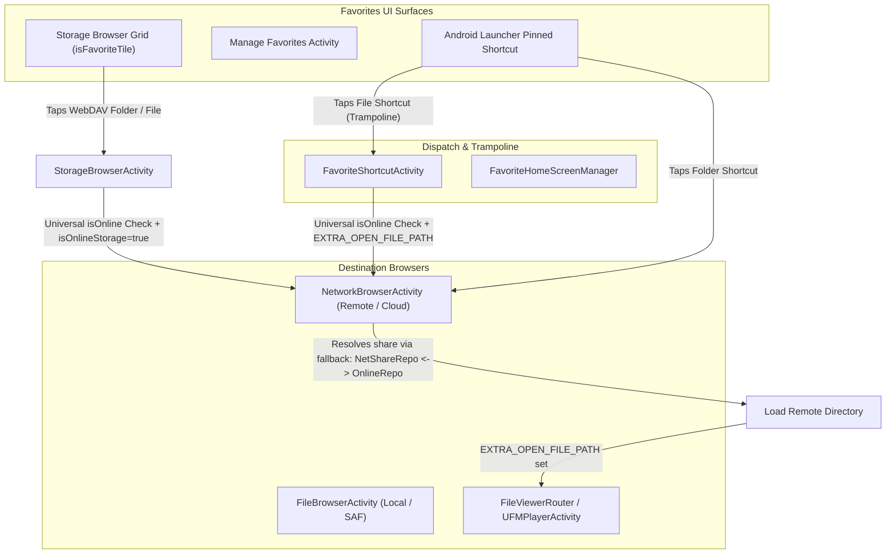

# Implementation Plan: Network & WebDAV Favorites Resolution, Connection Badging, and Shortcut UX

_Adhering to [UFMStandard](file:///F:/Share/UFM/.claude/memory/ufm_standard.md), [spec.md](file:///F:/Share/UFM/.plans/spec.md), and [clarifications.md](file:///F:/Share/UFM/.plans/clarifications.md)_

---

## 1. Overview & Architecture

This plan resolves the failures in in-app and home screen favorite shortcut handling for WebDAV and online cloud storages, adds connection protocol badging across all favorite surfaces, and implements a UFMStandard-compliant explanatory dialog for home screen shortcut removal.



---

## 2. Technical Decisions & Design Details

### 2.1 Universal Online Storage Identification Helper
Instead of hardcoding checks against `ShareType.ONEDRIVE` or `ShareType.GOOGLE_DRIVE`, create a single centralized resolution helper in a utility or repository:
```kotlin
fun isOnlineStorageShare(context: Context, shareId: String?, shareType: ShareType?): Boolean {
    if (shareId.isNullOrEmpty()) return false
    if (shareId.startsWith("tv_")) return false
    if (shareType?.isOnlineProvider == true) return true
    return OnlineStorageRepository.getInstance(context).getById(shareId) != null
}
```
This guarantees that WebDAV, Dropbox, Box, Mega, Nextcloud, pCloud, Yandex, S3, IDrive e2, OneDrive, and Google Drive are consistently recognized as online storage targets across all components.

### 2.2 Resilient Share Lookup in `NetworkBrowserActivity`
In `NetworkBrowserActivity.kt` lines 657–693:
- If `isOnlineStorage == true`, first query `OnlineStorageRepository.getById(shareId)`. If not found, fall back to `NetworkShareRepository.getById(shareId)`.
- If `isOnlineStorage == false`, first query `NetworkShareRepository.getById(shareId)`. If not found, fall back to `OnlineStorageRepository.getById(shareId)`.
- Only trigger `EXTRA_STORAGE_UNAVAILABLE_REDIRECT` if the share ID is absent from **both** repositories and is not a paired TV device.

### 2.3 File Launch from Network Favorites (`EXTRA_OPEN_FILE_PATH`)
In `NetworkBrowserActivity`:
- When launched with `EXTRA_OPEN_FILE_PATH` (e.g. from `FavoriteShortcutActivity` or in-app file favorite), load the directory listing, locate the target file, and trigger media/file opening via `FileViewerRouter` or streaming player.

### 2.4 In-App Subtitle Badging (`{Protocol} • {Folder/File}`)
In `StorageBrowserActivity.kt` (`buildAllKnownTiles`, `loadStorageVolumes`), `StorageAdapter.kt`, and `ManageFavoritesActivity.kt`:
- Resolve the protocol string dynamically:
  - If `item.favoriteIsNetwork`:
    - If `item.networkShare != null`: derive display label (`"WebDAV"`, `"SMB"`, `"NFS"`, `"FTP"`, `"SFTP"`, `"Google Drive"`, `"OneDrive"`, etc.).
    - Fallback: lookup by `fav.shareId` in `NetworkShareRepository` or `OnlineStorageRepository`.
  - If not network: `"Local"`.
- Format subtitle as: `"{Protocol} • {Type}"` (e.g. `"WebDAV • Folder"`, `"WebDAV • File"`, `"SMB • Folder"`, `"Local • Folder"`).

### 2.5 Home Screen Shortcut Icon Badging (`FavoriteIconComposer`)
- In `FavoriteIconComposer.kt`, render a small, high-contrast protocol pill badge (`WDAV`, `SMB`, `NFS`, `FTP`, `CLOUD`) onto the shortcut icon canvas in the corner.

### 2.6 UFMStandard Home Shortcut Removal Confirmation Dialog
- Layout: `dialog_remove_home_shortcut.xml` using `@drawable/bg_dialog_glass` and `R.style.UFM_Dialog`.
- Typography: Sans-serif-black title, 14sp secondary body.
- Buttons (Vertical Hierarchy per UFMStandard):
  - Mobile: Primary `MaterialButton` (`@style/Widget.Material3Expressive.Button`) "Disable Shortcut", Secondary `MaterialButton` (`@style/Widget.Material3Expressive.Button.TextButton`) "Cancel".
  - TV: Primary yellow selector (`@drawable/selector_tv_button_yellow`) "Disable Shortcut", Secondary selector (`@drawable/selector_tv_button`) "Cancel".
- Explanation text clearly explains that Android's OS API prevents apps from removing pinned icons directly from the launcher, requiring manual drag-to-delete.

---

## 3. Files Impacted

| File Path | Description of Changes |
| :--- | :--- |
| `app/src/main/java/za/kilowatch/ultimatefilemanager/storage/StorageBrowserActivity.kt` | Use universal online check when launching favorite folders/files with `NetworkBrowserActivity`. Update favorite tile subtitle to `"{Protocol} • {Folder/File}"`. |
| `app/src/main/java/za/kilowatch/ultimatefilemanager/network/NetworkBrowserActivity.kt` | Add cross-repository fallback in `initNetworkClient()` to prevent false redirect. Ensure `EXTRA_OPEN_FILE_PATH` auto-opens the remote file. |
| `app/src/main/java/za/kilowatch/ultimatefilemanager/shortcuts/FavoriteShortcutActivity.kt` | Populate `putExtra("isOnlineStorage", true)` and `EXTRA_STORAGE_LABEL` for remote file favorites. |
| `app/src/main/java/za/kilowatch/ultimatefilemanager/shortcuts/FavoriteHomeScreenManager.kt` | Enhance file intent generation and support protocol metadata. |
| `app/src/main/java/za/kilowatch/ultimatefilemanager/shortcuts/FavoriteIconComposer.kt` | Draw compact protocol badge pill (`WDAV`, `SMB`, `NFS`, `FTP`, `CLOUD`) on generated launcher icons. |
| `app/src/main/java/za/kilowatch/ultimatefilemanager/storage/StorageAdapter.kt` | Update `isFavoriteTile` subtitle formatting to display `"{Protocol} • {Type}"`. |
| `app/src/main/java/za/kilowatch/ultimatefilemanager/settings/ManageFavoritesActivity.kt` | Show protocol badge next to items and integrate the UFMStandard shortcut removal confirmation dialog. |
| `app/src/main/res/layout/dialog_remove_home_shortcut.xml` | UFMStandard glass confirmation dialog for shortcut disabling explanation. |
| `app/src/main/res/values/strings.xml` | String resources for protocol subtitle formats and shortcut removal dialog copy. |

---

## 4. Verification Plan

1. **In-App WebDAV Navigation**:
   - Create favorite WebDAV folder and file.
   - Tap folder on main storage grid -> verifies opens cleanly in `NetworkBrowserActivity` without redirect.
   - Tap file on main storage grid -> verifies file opens in viewer/player.
2. **Home Screen Shortcut Launching**:
   - Pin WebDAV file shortcut to Android home screen.
   - Tap home screen shortcut -> verifies opens `NetworkBrowserActivity` into parent folder and launches file viewer, with no redirect error.
3. **Protocol Badges**:
   - Verify storage tiles display `"WebDAV • Folder"`, `"WebDAV • File"`, `"SMB • Folder"`, etc.
   - Verify `ManageFavoritesActivity` displays protocol pills.
   - Verify home screen shortcut icon has protocol overlay.
4. **Shortcut Removal Dialog**:
   - Remove shortcut from Manage Favorites -> verifies UFMStandard dialog appears with clear OS limitation explanation and working cancel/disable actions.
