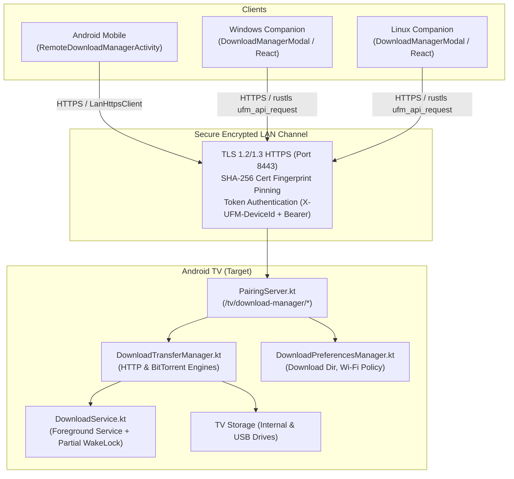

# Implementation Plan: Remote TV Download Manager (Mobile, Windows & Linux Companions)

## Overview
This plan specifies the implementation architecture, file modifications, and verification steps for enabling full remote management of Ultimate File Manager Pro's Download Manager on Android TV from Android Mobile, Windows Companion (`UFM-Windows`), and Linux Companion (`UFM-Linux`).

---

## Architecture & Data Flow



---

## Proposed Changes

### Component 1: Android TV Backend API (`PairingServer.kt`)
#### `[MODIFY] app/src/main/java/za/kilowatch/ultimatefilemanager/network/PairingServer.kt`
- Add route routing for `/tv/download-manager/*`:
  - `GET /tv/download-manager/status` -> `handleTvDownloadStatus()`
  - `POST /tv/download-manager/settings` -> `handleTvDownloadSettings(session)`
  - `POST /tv/download-manager/action` -> `handleTvDownloadAction(session)`
  - `POST /tv/download-manager/add-url` -> `handleTvDownloadAddUrl(session)`
  - `POST /tv/download-manager/add-magnet` -> `handleTvDownloadAddMagnet(session)`
  - `POST /tv/download-manager/add-torrent` -> `handleTvDownloadAddTorrent(session)`
- Implementation details:
  - Enforce `authorized == true` check and RFC1918/loopback check.
  - In `handleTvDownloadStatus`: query `DownloadPreferencesManager.getDownloadDir()`, compute `StatFs` free/total space, read `networkPolicy`, read `isLegalAccepted()`, and serialize `DownloadTransferManager.getAllTransfers()` into a clean JSON array.
  - In `handleTvDownloadAction`: execute `pauseTransfer()`, `resumeTransfer()`, `retryTransfer()`, or `cancelTransfer(id, deleteFiles = deleteFiles)`.
  - In `handleTvDownloadAddTorrent`: decode Base64 payload, save to cache directory as a temporary `.torrent` file, apply `selectedIndices: Set<Int>?`, and invoke `DownloadTransferManager.startTorrentFileDownload()`.

---

### Component 2: Android Mobile Network Client (`TvShareClient.kt`)
#### `[MODIFY] app/src/main/java/za/kilowatch/ultimatefilemanager/network/TvShareClient.kt`
- Add models and network helper methods:
  - `data class RemoteDownloadSettings(val downloadDir: String, val freeBytes: Long, val totalBytes: Long, val networkPolicy: String, val legalAccepted: Boolean)`
  - `data class RemoteTransferItem(val id: String, val title: String, val type: String, val state: String, val totalBytes: Long, val downloadedBytes: Long, val progressPercent: Int, val speedBytesPerSec: Long, val etaSeconds: Long, val connectedPeers: Int, val totalPeers: Int, val connectedSeeds: Int, val targetFolder: String, val errorMessage: String?)`
  - `data class RemoteDownloadStatus(val settings: RemoteDownloadSettings, val transfers: List<RemoteTransferItem>)`
  - `suspend fun getDownloadManagerStatus(share: NetworkShare): RemoteDownloadStatus?`
  - `suspend fun updateDownloadSettings(share: NetworkShare, downloadDir: String?, networkPolicy: String?): Boolean`
  - `suspend fun executeTransferAction(share: NetworkShare, id: String, action: String, deleteFiles: Boolean): Boolean`
  - `suspend fun addDirectDownload(share: NetworkShare, url: String, filename: String?, headers: Map<String, String>?): Boolean`
  - `suspend fun addMagnetDownload(share: NetworkShare, magnetUri: String, saveDir: String?): Boolean`
  - `suspend fun addTorrentDownload(share: NetworkShare, torrentBytes: ByteArray, saveDir: String?, selectedIndices: List<Int>?): Boolean`

---

### Component 3: Android Mobile TV Browser Root Entry (`NetworkBrowserActivity.kt`)
#### `[MODIFY] app/src/main/java/za/kilowatch/ultimatefilemanager/network/NetworkBrowserActivity.kt`
- Define sentinel constant:
  ```kotlin
  const val DOWNLOAD_MANAGER_PATH = "__download_manager__"
  ```
- In `loadDirectory()` (around line 3740):
  When `isTvRoot == true`, append `NetworkFile` for Download Manager:
  ```kotlin
  NetworkFile(
      name = getString(R.string.download_manager_title),
      path = DOWNLOAD_MANAGER_PATH,
      isDirectory = false,
      iconRes = R.drawable.ic_download,
      subtitle = getString(R.string.tv_download_manager_subtitle)
  )
  ```
- In `onItemClick` (around line 1147):
  Intercept `DOWNLOAD_MANAGER_PATH` and launch `RemoteDownloadManagerActivity`:
  ```kotlin
  DOWNLOAD_MANAGER_PATH -> {
      val pairedDeviceId = intent.getStringExtra(EXTRA_PAIRED_DEVICE_ID) ?: ""
      val intent = Intent(this@NetworkBrowserActivity, RemoteDownloadManagerActivity::class.java).apply {
          putExtra(EXTRA_PAIRED_DEVICE_ID, pairedDeviceId)
          putExtra(RemoteDownloadManagerActivity.EXTRA_SHARE_HOST, share.host)
          putExtra(RemoteDownloadManagerActivity.EXTRA_SHARE_PORT, share.port)
          putExtra(RemoteDownloadManagerActivity.EXTRA_DEVICE_NAME, share.name)
      }
      startActivity(intent)
      return@NetworkFileAdapter
  }
  ```

---

### Component 4: Android Mobile Remote Download Activity & UI
#### `[NEW] app/src/main/java/za/kilowatch/ultimatefilemanager/download/RemoteDownloadManagerActivity.kt`
- Implements:
  - 1.5s coroutine polling loop during `Lifecycle.State.RESUMED`.
  - Storage location card with free space bar and "Change Location" button.
  - Interactive TV Storage Explorer dialog (browses TV drives & folders via `TvShareClient.listFiles`, supports folder creation via `TvShareClient.mkdir`).
  - Transfers `RecyclerView` using DiffUtil for smooth updates.
  - Per-item controls: Pause, Resume, Retry, and Delete.
  - Delete confirmation dialog (`dialog_transfer_delete_confirm`) with:
    - "Remove from List Only" (`deleteFiles = false`)
    - "Delete Files & Remove" (`deleteFiles = true`)
  - Top toolbar menu: "Clear Completed", "Refresh", and "Wi-Fi Only Toggle".
  - Add Download FAB / Menu:
    - Direct Download URL dialog
    - Magnet Link input dialog (auto-clipboard paste)
    - .Torrent file picker (reads file with `TorrentInfo`, presents sub-file checklist modal, dispatches Base64 payload + `selectedIndices`).
#### `[NEW] app/src/main/res/layout/activity_remote_download_manager.xml`
- Glassmorphic / Material 3 Expressive layout with app bar, TV status badge, storage location card, transfers recycler, and empty state.
#### `[NEW] app/src/main/res/layout/item_remote_download_transfer.xml`
- Card layout displaying title, type badge, status badge, progress bar, downloaded/total size, speed, ETA, peers/seeds, and action buttons.
#### `[NEW] app/src/main/res/layout/dialog_remote_tv_folder_picker.xml`
- Dialog layout for navigating TV storage partitions and directories.
#### `[MODIFY] app/src/main/AndroidManifest.xml`
- Register `RemoteDownloadManagerActivity` with appropriate theme and window soft input settings.
#### `[MODIFY] app/src/main/res/values/strings.xml`
- Add necessary string resources (`tv_download_manager_subtitle`, `tv_storage_location`, `clear_completed_transfers`, `change_tv_storage_location`, `add_direct_download`, `add_magnet_link`, `add_torrent_file`, etc.).

---

### Component 5: Desktop Companions (`UFM-Windows` & `UFM-Linux`)
#### `[NEW] UFM-Windows/src/components/DownloadManagerModal.tsx` & `UFM-Linux/src/components/DownloadManagerModal.tsx`
- React modal component:
  - Connects to the active paired TV via Tauri command `ufm_api_request`.
  - Initiates 1.5s polling loop when open.
  - Displays TV storage card (path, free/total space) and remote folder selector.
  - Displays transfer cards with real-time %, speeds, ETAs, and peers/seeds.
  - Controls: Pause, Resume, Retry, Delete ("Remove from list only" vs "Delete files & remove").
  - Add Transfer actions:
    - Direct URL input
    - Magnet link input
    - .Torrent file picker using `@tauri-apps/plugin-dialog` or file input, base64 encoding, and dispatching to `/tv/download-manager/add-torrent`.
#### `[MODIFY] UFM-Windows/src/App.tsx` & `UFM-Linux/src/App.tsx`
- Add Download Manager icon button (`DownloadCloud` / `Download`) to top navigation bar.
- Manage `showDownloadManager` state and render `<DownloadManagerModal />`.
#### `[MODIFY] UFM-Windows/src/hooks/translations.ts` & `UFM-Linux/src/hooks/translations.ts`
- Add localized strings for the Download Manager modal.

---

## Verification Plan

### Automated Tests
1. **Lint & Resource Compilation**:
   ```powershell
   ./gradlew assembleDebug
   ```
2. **Unit Tests**:
   ```powershell
   ./gradlew testDebugUnitTest --tests "za.kilowatch.ultimatefilemanager.*"
   ```
3. **Companion Build Check**:
   ```powershell
   cd UFM-Windows; npm run build; cd ..
   cd UFM-Linux; npm run build; cd ..
   ```

### Manual Verification
1. **Pairing & Root Entry**:
   - Pair a mobile device with an Android TV.
   - Open the paired TV from Mobile (`NetworkBrowserActivity`).
   - Verify that "Download Manager" appears in the TV root actions list with `ic_download`.
2. **Remote Monitoring & Controls**:
   - Tap "Download Manager" on Mobile; verify `RemoteDownloadManagerActivity` launches and displays TV storage and active downloads.
   - Tap Pause/Resume on a downloading item; verify TV responds immediately.
   - Tap Delete; verify prompt offers "Remove from list only" and "Delete files & remove". Test both options.
3. **Remote Storage Location**:
   - Tap "Change Location" on Mobile; traverse TV Internal and USB drives in the TV storage explorer.
   - Select a new directory; verify TV updates `DownloadPreferencesManager.getDownloadDir()`.
4. **Adding Downloads**:
   - Add a direct HTTP file URL; verify TV begins downloading.
   - Add a Magnet link; verify TV resolves metadata and begins downloading.
   - Pick a local `.torrent` file, uncheck 1 file in the sub-file picker, and dispatch; verify TV downloads only selected files.
5. **Desktop Companion Verification**:
   - Connect Windows/Linux companion to the paired TV.
   - Click the "Download Manager" top bar button.
   - Verify the dashboard mirrors live progress and allows all actions (Pause, Resume, Delete, Add URL/Magnet/.torrent).
