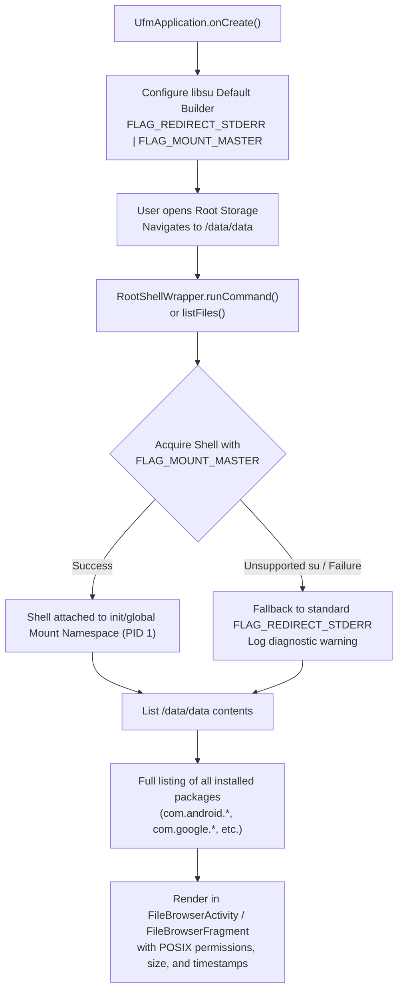

# Implementation Plan: Root Storage Global Mount Namespace Access

## Goals
Enable complete, unrestricted visibility and file management across all directories in root storage—specifically `/data/data` and `/data/user/0`—on modern Android versions (Android 14+, Android 15, and Android 16 on devices such as Nothing Phone 2a).
- Fix the issue where only `com.google.android.gms` and `za.kilowatch.ultimatefilemanager` are displayed when browsing `/data/data` with root privileges.
- Ensure elevated sessions attach to the global/master mount namespace (`su --mount-master` / `FLAG_MOUNT_MASTER`) instead of inheriting the app's sandboxed mount namespace.
- Provide automatic graceful fallback for legacy root binaries that do not support `--mount-master`.
- Satisfy all success criteria defined in `.plans/spec.md` and confirmed in `.plans/clarifications.md`.

---

## Architecture Overview

### Key Architectural Decisions
1. **Master Mount Namespace by Default (`FLAG_MOUNT_MASTER`):**
   In `UfmApplication.kt`, configure `Shell.setDefaultBuilder` with `Shell.FLAG_REDIRECT_STDERR or Shell.FLAG_MOUNT_MASTER`. This instructs `libsu` to pass `--mount-master` to the root daemon (`su`), switching the shell session into the global mount namespace (`/proc/1/ns/mnt`). In this namespace, all package directories in `/data/data` and `/data/user/0` are visible.
2. **Resilient Shell Fallback in `RootShellWrapper`:**
   In case a device runs an older or non-standard `su` binary that errors on `--mount-master`, `RootShellWrapper` will implement a fallback mechanism: catching initialization failure, resetting the builder to `FLAG_REDIRECT_STDERR`, and re-acquiring the shell.
3. **Mount-Master Process Streams:**
   In `RootShellWrapper.openInputStream` and `RootShellWrapper.openOutputStream`, include `--mount-master` when spawning `su` processes for streaming file reads and writes, with standard `su` fallback if rejected.
4. **App Sandbox Path Filtering Refinement:**
   In `RootShellWrapper.isRootPath()`, remove the blanket package-name exclusion that was falsely disqualifying `/data/data/za.kilowatch.ultimatefilemanager` and its subdirectories from being treated as root paths during root storage browsing (confirming Clarification Q3).

---

## Files to Create
*None* (All changes are enhancements to existing architecture and test suites).

---

## Files to Modify

### `app/src/main/java/za/kilowatch/ultimatefilemanager/UfmApplication.kt`
- **What:** Update libsu initialization in `onCreate()`.
- **Key details:** Combine `Shell.FLAG_REDIRECT_STDERR` with `Shell.FLAG_MOUNT_MASTER` in `Shell.setDefaultBuilder`.

### `app/src/main/java/za/kilowatch/ultimatefilemanager/storage/RootShellWrapper.kt`
- **What:** Add resilient fallback handling, mount-master support for `ProcessBuilder` streams, and refine `isRootPath()`.
- **Key details:**
  - Track whether master mount namespace is active; if `Shell.getShell()` fails with master mount flags, fall back to standard flags.
  - In `openInputStream` and `openOutputStream`, pass `--mount-master` when master mount is active.
  - In `isRootPath(path)`, allow paths under `/data/data` and `/data/user` containing the package name so UFM's own directory can be browsed and managed when operating in root mode, while maintaining isolation for transient app staging/cache paths.

### `app/src/test/java/za/kilowatch/ultimatefilemanager/storage/RootShellWrapperTest.kt`
- **What:** Expand unit test suite.
- **Key details:**
  - Add tests verifying `isRootPath` for `/data/data`, `/data/user/0`, and package paths.
  - Verify that regular external storage (`/storage/emulated/0`) and SAF paths remain excluded.

---

## Data Model
No database schema changes or SharedPreferences format changes required.

---

## Dependencies
No new dependencies. `com.github.topjohnwu.libsu:core:6.0.0` is already present in `libs.versions.toml` and supports `Shell.FLAG_MOUNT_MASTER`.

---

## Test Plan

### Automated Tests
1. **Robolectric Unit Tests:**
   Run `./gradlew testMobileGoogleDebugUnitTest --tests za.kilowatch.ultimatefilemanager.storage.RootShellWrapperTest` to verify root path resolution and regex validation.
2. **Build Verification:**
   Run `./gradlew assembleMobileGoogleDebug` to guarantee clean compilation without errors or regressions.

### Manual Verification
1. On Nothing Phone (2a) running Android 16 (or rooted Android 14/15/16 emulator/device with Magisk/KernelSU/APatch):
   - Open UFM -> Main Menu -> Root Storage.
   - Navigate to `/data/data`.
   - Verify that all installed package directories (e.g. `android.*`, `com.google.*`, all third-party apps) are listed, matching the expected output from the reference file manager in [storage.jpeg](file:///F:/Share/UFM/images/storage.jpeg).
   - Verify item counts, POSIX permissions (`drwxrwx--x`), and timestamps render accurately.
   - Enter a package directory (e.g. `com.google.android.gms` or another package) and verify subdirectories (`files`, `databases`, `shared_prefs`) are browseable.
   - Verify that `/data/data/za.kilowatch.ultimatefilemanager` can be opened in Root Storage mode.

---

## Risks & Mitigations
- **Risk:** Some legacy `su` binaries or unusual custom ROM root implementations fail when passed `--mount-master`.
  - **Mitigation:** Implement proactive try/catch fallback in `RootShellWrapper` to retry shell initialization with standard `FLAG_REDIRECT_STDERR`.
- **Risk:** App cache files or staging files inadvertently treated as root files during non-root editing.
  - **Mitigation:** Explicitly restrict sandbox exclusion relaxation to paths starting with `/data/data` or `/data/user`, keeping standard cache and staging handlers intact.
