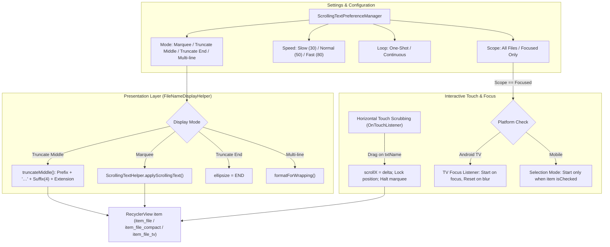

# Implementation Plan: Enhanced Long Filename Display & Interactive Scrolling Options

## Goals
Implement advanced long filename display and customizable scrolling capabilities to solve the problem of indistinguishable long filenames in single-line listings, satisfying all success criteria in `.plans/spec.md` and user clarifications in `.plans/clarifications.md`:
- Introduce **Truncate Middle** mode (`prefix...suffix.ext`) preserving base prefix, ellipsis, at least 4 trailing characters of the base name, and the full extension.
- Provide **customizable marquee scrolling**:
  - Scroll Speed: *Slow* (30 dp/s), *Normal* (50 dp/s, default), *Fast* (80 dp/s).
  - Loop Behavior: *One-Shot* (default) vs *Continuous Loop*.
  - Scroll Scope: *All Visible Files* (default) vs *Focused / Selected Only*.
- Enable **manual horizontal touch scrubbing** on single-line filenames so users can drag across the text to inspect any part of the name, remaining fixed at the scrubbed position until recycled off-screen.
- Provide a **unified settings UI** adhering to `UFMStandard` on both Mobile and Android TV with an interactive live preview.

---

## Architecture Overview

### Architectural Decisions

1. **Middle Truncation Algorithm**:
   - `FileNameDisplayHelper.truncateMiddle(fileName, paint, availableWidthPx, keepSuffixChars = 4)`:
     - Identifies compound extensions (e.g. `.tar.gz`, `.tar.bz2`) using known archive patterns and standard dot extension extraction.
     - Splits into `baseName` and `extension`.
     - Preserves the full extension and at least 4 trailing characters of the base name (`suffix = baseName.takeLast(4) + ext`).
     - Calculates available width for prefix: `availableWidth - paint.measureText("…" + suffix)`.
     - Measures and trims `baseName` prefix to fit.
     - If width is too narrow even for suffix + ellipsis, gracefully falls back to native truncation (`TextUtils.TruncateAt.MIDDLE`).

2. **Touch Scrubbing & Gesture Disambiguation**:
   - Implemented via a lightweight touch listener attached to single-line `TextView` (`ScrollingTextHelper.attachTouchScrubbing(textView, fullFileName)`).
   - Distinguishes between:
     - **Tap**: `abs(dx) < touchSlop && abs(dy) < touchSlop` -> calls `textView.performClick()` to open or select file.
     - **Vertical list scroll**: `abs(dy) > abs(dx) && abs(dy) > touchSlop` -> yields touch events to RecyclerView.
     - **Horizontal text scrub**: `abs(dx) > abs(dy) && abs(dx) > touchSlop` -> calls `requestDisallowInterceptTouchEvent(true)`, computes `scrollX.coerceIn(0, maxOverflow)`, and halts active marquee animations for that view instance.
   - Text remains fixed at the scrubbed position until the ViewHolder is recycled (`recycle()`) or re-bound (`applyFileNameDisplay()`).

3. **Marquee Engine Enhancements**:
   - `ScrollingTextHelper` updated to query configured scroll speed (dp/s) and loop mode.
   - `Continuous` mode chains an additional delayed callback from `scrollOneWay(forward = false)` back to `scrollOneWay(forward = true)` with a 1500ms initial pause.
   - `Scope` check ensures animations only trigger if allowed by selection state on mobile or focus state on TV.

4. **UFMStandard Compliance & TV Layout**:
   - `dialog_file_name_display.xml` updated with `Truncate Middle` card, expandable Marquee sub-options, and an animated live preview card.
   - `dialog_file_name_display_tv.xml` created for Android TV with D-pad focus traversal, glass dialog styling (`@drawable/bg_dialog_glass`), 650dp width, and yellow focus selectors.

---

## Files to Modify

### `app/src/main/java/za/kilowatch/ultimatefilemanager/settings/ScrollingTextPreferenceManager.kt`
- Add `MODE_TRUNCATE_MIDDLE = "truncate_middle"`.
- Add preferences keys:
  - `KEY_SCROLL_SPEED = "scrolling_text_speed"` (values: `SPEED_SLOW`, `SPEED_NORMAL`, `SPEED_FAST`).
  - `KEY_LOOP_MODE = "scrolling_text_loop"` (values: `LOOP_ONE_SHOT`, `LOOP_CONTINUOUS`).
  - `KEY_SCROLL_SCOPE = "scrolling_text_scope"` (values: `SCOPE_ALL`, `SCOPE_FOCUSED`).
- Add getter and setter functions with defaults (`SPEED_NORMAL`, `LOOP_ONE_SHOT`, `SCOPE_ALL`).

### `app/src/main/java/za/kilowatch/ultimatefilemanager/settings/ScrollingTextHelper.kt`
- Read dynamic scroll speed in `scrollOneWay`:
  - Slow: 30 dp/s, Normal: 50 dp/s, Fast: 80 dp/s.
- Support continuous looping when `LOOP_CONTINUOUS` is enabled.
- Add `attachTouchScrubbing(textView: TextView, fullFileName: String)` and tracking for manually scrubbed views.
- Add `cancelScrolling(textView: TextView)` enhancements to reset manual scrub state when recycled.

### `app/src/main/java/za/kilowatch/ultimatefilemanager/settings/FileNameDisplayHelper.kt`
- Add `truncateMiddle(fileName: String, paint: Paint, availableWidth: Float, keepSuffixChars: Int = 4): String`.
- Support `MODE_TRUNCATE_MIDDLE` in `applyFileNameDisplay`:
  - Configures single-line layout and calculates prefix/suffix middle truncation.
- Update `applyFileNameDisplay` to accept `isSelected: Boolean = false` and `isFocused: Boolean = false` parameters.
- Attach manual touch scrubbing for all single-line modes on mobile touch devices.

### `app/src/main/java/za/kilowatch/ultimatefilemanager/storage/FileAdapter.kt`
- Pass `isSelected = (file.absolutePath in selectedPaths)` to `FileNameDisplayHelper.applyFileNameDisplay`.
- In TV `itemView.setOnFocusChangeListener`, notify `ScrollingTextHelper` to start/stop scrolling for `SCOPE_FOCUSED`.
- In `recycle()`, ensure `ScrollingTextHelper.cancelScrolling(txtName)` resets scroll offset and scrub state.

### `app/src/main/java/za/kilowatch/ultimatefilemanager/network/NetworkFileAdapter.kt`
- Pass `isSelected = (file in selectedFiles)` to `FileNameDisplayHelper.applyFileNameDisplay`.
- Handle TV focus change for `SCOPE_FOCUSED`.
- In `recycle()`, ensure `ScrollingTextHelper.cancelScrolling(txtName)` is called.

### `app/src/main/java/za/kilowatch/ultimatefilemanager/settings/SettingsActivity.kt`
- Update `updateFileNameDisplaySubtitle()` to reflect `MODE_TRUNCATE_MIDDLE`.
- Enhance `showFileNameDisplayDialog()`:
  - Support dual layouts (`dialog_file_name_display.xml` on mobile, `dialog_file_name_display_tv.xml` on TV).
  - Handle selection for `btnModeTruncateMiddle`.
  - Wire up Speed chips/radios (Slow, Normal, Fast).
  - Wire up Loop mode chips/radios (One-Shot, Continuous).
  - Wire up Scope chips/radios (All Files, Focused / Selected Only).
  - Bind interactive live preview TextView showing sample long filename animating with active preferences.

### `app/src/main/res/layout/dialog_file_name_display.xml`
- Add option card for `btnModeTruncateMiddle`.
- Add inline Marquee sub-options container with chip groups / option rows for Speed, Loop, and Scope.
- Add live preview card displaying sample text.

### `app/src/main/res/values/strings.xml`
- Add string resources:
  - `settings_file_name_display_truncate_middle`
  - `settings_file_name_display_truncate_middle_desc`
  - `settings_marquee_speed_title`, `settings_marquee_speed_slow`, `settings_marquee_speed_normal`, `settings_marquee_speed_fast`
  - `settings_marquee_loop_title`, `settings_marquee_loop_one_shot`, `settings_marquee_loop_continuous`
  - `settings_marquee_scope_title`, `settings_marquee_scope_all`, `settings_marquee_scope_focused`
  - `settings_file_name_preview_title`

---

## Files to Create

### `app/src/main/res/layout/dialog_file_name_display_tv.xml`
- **What:** TV-optimized version of the file name display & marquee options dialog.
- **Key details:**
  - Follows `UFMStandard` dialog pattern (`@drawable/bg_dialog_glass`, 650dp width).
  - Focusable option cards with `@drawable/selector_tv_button` / `@drawable/selector_btn_glass_yellow`.
  - D-pad friendly layout for switching display mode, speed, loop, and scope.

---

## Data Model & Preferences Keys
Stored in `scrolling_text_prefs` (already registered in `SettingsBackupManager`):

| Key | Type | Possible Values | Default |
|---|---|---|---|
| `file_name_display_mode` | String | `marquee`, `truncate_middle`, `truncate`, `multiline_2`, `multiline_3`, `multiline_unlimited` | `marquee` |
| `scrolling_text_speed` | String | `slow`, `normal`, `fast` | `normal` |
| `scrolling_text_loop` | String | `one_shot`, `continuous` | `one_shot` |
| `scrolling_text_scope` | String | `all`, `focused` | `all` |

---

## Dependencies
- No external libraries required. Uses standard Android SDK (`ObjectAnimator`, `TextView.scrollX`, `ViewConfiguration.scaledTouchSlop`, `Paint.measureText`).
- Zero impact on DEX size or R8 optimization scores.

---

## Test Plan
- **Middle Truncation Verification**:
  - Test files with standard long names: `my_document_backup_2026_version_1.docx` -> verify `my_docum...on_1.docx`.
  - Test compound extensions: `archive_backup_daily_system.tar.gz` -> verify `.tar.gz` is intact.
  - Test extensionless files: `README_CONTAINING_VERY_LONG_INSTRUCTIONS` -> verify middle truncation without crash.
  - Test short files: `file.txt` -> verify no ellipsis is inserted.
- **Marquee Settings Verification**:
  - Verify Slow (~30 dp/s), Normal (~50 dp/s), and Fast (~80 dp/s) scroll speeds.
  - Verify One-Shot stops after 1 cycle; verify Continuous repeats smoothly.
  - Verify Scope `focused`:
    - Mobile: files don't scroll unless selected via multi-select checkbox.
    - TV: only the focused file row scrolls.
- **Touch Scrubbing Verification**:
  - Drag horizontally on long file name: verify text follows finger movement and stays at scrubbed offset.
  - Tap normally on file name: verify file opens / selects without being blocked by touch listener.
  - Scroll list vertically: verify vertical RecyclerView flinging is smooth without hindrance.
- **Settings & Backup**:
  - Export settings backup, restore, verify all preferences are preserved.
- **Build Verification**:
  - Compile with `./gradlew assembleMobileGoogleDebug` to guarantee clean build.
- **Translation Verification**:
  - Run `python -u translate_strings.py verify` to sync new strings.

---

## Risks & Mitigations
- **Risk:** Touch scrubbing on `txtName` blocks vertical RecyclerView scrolling.  
  **Mitigation:** Use `ViewConfiguration.scaledTouchSlop` and check `abs(dx) > abs(dy)`. Only request disallow intercept if the horizontal delta exceeds touch slop.
- **Risk:** Middle truncation calculations cause layout stutter during RecyclerView scrolling.  
  **Mitigation:** `truncateMiddle` performs simple string slicing and single paint measure passes without creating complex views or spawning threads. Results can be cached or computed when width is known.
- **Risk:** Marquee animator memory leaks on recycled rows.  
  **Mitigation:** `cancelScrolling` in `onViewRecycled` / `recycle()` explicitly removes all animator listeners and cancels the animator.
