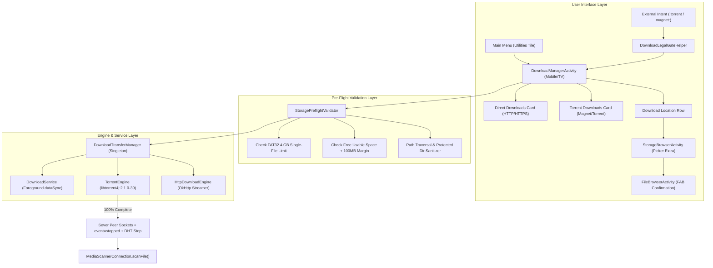

# Implementation Plan: Unified Download Manager (Torrent, Magnet & HTTP/HTTPS)

## Goal Description
Build and integrate a native, high-performance, and privacy-hardened **Download Manager** into **Ultimate File Manager Pro (UFM)** for Mobile and Android TV. The system provides unified management for both **BitTorrent / Magnet** downloads (via `libtorrent4j:2.1.0-39` with strict zero-seeding and immediate post-download swarm ejection) and **Direct HTTP/HTTPS** file downloads.

The feature will be exposed via a new **Download Manager** tile under the **Utilities** category on the Main Menu, modeled visually after [`images/layout.jpeg`](file:///F:/Share/UFM/images/layout.jpeg), backed by UFM's canonical **Folder Picker Standard** with Floating Action Button (FAB) confirmation, pre-flight FAT32 / capacity checks, and full compliance with UFM's legal, privacy, and non-piracy policies (dated November 2026).

---

## User Review Required

> [!IMPORTANT]
> **Strict Zero-Seeding & Instant Swarm Ejection**:
> The BitTorrent engine enforces `active_seeds = 0`, `seeding_outgoing_connections = false`, and `upload_rate_limit = 1`. The millisecond a download reaches 100%, all peer sockets are severed, trackers receive `event=stopped`, and DHT unregisters the info-hash so the user's IP address ceases being exposed in the swarm.

> [!IMPORTANT]
> **Mandatory First-Use Legal Gate**:
> Users are gated on first access by a modern UFMStandard glass dialog requiring an explicit interactive tick acknowledging lawful use only, P2P IP visibility, and prohibition of piracy. The **Continue** button remains disabled until checked.

> [!NOTE]
> **Translation Cleanup Requirement**:
> Per project rules in [.agents/AGENTS.md](file:///F:/Share/UFM/.agents/AGENTS.md), modifying `policy_last_updated` to November 2026 and adding new policy entries in `strings_policy.xml` requires deleting those modified keys from all 17 non-English translation files (`values-*/strings_policy.xml`).

---

## Architecture & Data Flow



---

## Proposed Changes

Grouped by component layer in order of execution.

---

### 1. Dependencies & Build Configuration

#### [MODIFY] [gradle/libs.versions.toml](file:///F:/Share/UFM/gradle/libs.versions.toml)
- Add `libtorrent4j = "2.1.0-39"` under `[versions]`.
- Add libraries under `[libraries]`:
  ```toml
  libtorrent4j-core = { group = "org.libtorrent4j", name = "libtorrent4j", version.ref = "libtorrent4j" }
  libtorrent4j-arm = { group = "org.libtorrent4j", name = "libtorrent4j-android-arm", version.ref = "libtorrent4j" }
  libtorrent4j-arm64 = { group = "org.libtorrent4j", name = "libtorrent4j-android-arm64", version.ref = "libtorrent4j" }
  libtorrent4j-x86 = { group = "org.libtorrent4j", name = "libtorrent4j-android-x86", version.ref = "libtorrent4j" }
  libtorrent4j-x86_64 = { group = "org.libtorrent4j", name = "libtorrent4j-android-x86_64", version.ref = "libtorrent4j" }
  ```

#### [MODIFY] [app/build.gradle.kts](file:///F:/Share/UFM/app/build.gradle.kts)
- Include `libtorrent4j` dependencies:
  ```kotlin
  implementation(libs.libtorrent4j.core)
  implementation(libs.libtorrent4j.arm)
  implementation(libs.libtorrent4j.arm64)
  implementation(libs.libtorrent4j.x86)
  implementation(libs.libtorrent4j.x86.64)
  ```
- Ensure `licensee` configuration handles `libtorrent4j` (BSD-3-Clause and MIT are allowed; ignore auxiliary sub-artifacts if needed).

#### [MODIFY] [app/proguard-rules.pro](file:///F:/Share/UFM/app/proguard-rules.pro)
- Add minimal, non-blanket keep rules conforming to R8 policy:
  ```proguard
  # libtorrent4j JNI bridge
  -keep class org.libtorrent4j.swig.libtorrent_jni { *; }
  -keepclassmembers class org.libtorrent4j.** {
      public <init>(...);
  }
  ```

---

### 2. Legal, Terms, Privacy & Policy Documentation

#### [MODIFY] [WEBSITE/UFMPrivacyPolicy.html](file:///F:/Share/UFM/WEBSITE/UFMPrivacyPolicy.html)
- Update badge date: `<span class="policy-badge">Last Updated: August 2026</span>` → `<span class="policy-badge">Last Updated: November 2026</span>`.
- Add subsection on **BitTorrent & P2P Swarm Communications**:
  - Explain P2P decentralized mechanics and direct peer IP sharing during download.
  - Detail post-download instant disconnection (`event=stopped` and peer socket teardown).
  - Confirm local file sandboxing (no user media or Encrypted Vault files accessible to peers).

#### [MODIFY] [WEBSITE/UFMTerms.html](file:///F:/Share/UFM/WEBSITE/UFMTerms.html)
- Update badge date: `<span class="policy-badge">Last Updated: August 2026</span>` → `<span class="policy-badge">Last Updated: November 2026</span>`.
- Add comprehensive section on **Download Manager — Acceptable Use & Non-Piracy Policy**:
  - Sole intended use: lawful, open-source, public domain, and authorized content.
  - Strict anti-piracy prohibition; user indemnity for copyright violations.
  - Impartial tool disclaimer: KiloWatch hosts no swarms, trackers, or torrent content.

#### [MODIFY] [app/src/main/res/values/strings_policy.xml](file:///F:/Share/UFM/app/src/main/res/values/strings_policy.xml)
- Update `policy_last_updated`: `Last Updated: November 2026`.
- Add Download Manager to `tc_features`.
- Add anti-piracy obligation to `tc_s4`.
- Add `libtorrent4j` attribution to `tc_opensource`.
- Add string resources for Legal Gate dialog, storage limits, and Wi-Fi warnings.

#### [DELETE] Translation keys from `app/src/main/res/values-*/strings_policy.xml`
- Delete `policy_last_updated`, `tc_features`, `tc_s4`, and `tc_opensource` from all 17 non-English language files per the Translation Cleanup rule in `AGENTS.md`.

#### [MODIFY] [app/src/main/java/za/kilowatch/ultimatefilemanager/ui/policy/LicensesActivity.kt](file:///F:/Share/UFM/app/src/main/java/za/kilowatch/ultimatefilemanager/ui/policy/LicensesActivity.kt)
- Add `libtorrent4j (org.libtorrent4j:libtorrent4j)` version `2.1.0-39`, `BSD-3-Clause / MIT` to `loadLibraries()` and `staticFallback()`.

---

### 3. Main Menu Tile Integration ("Utilities" Category)

#### [MODIFY] [app/src/main/java/za/kilowatch/ultimatefilemanager/storage/StorageItem.kt](file:///F:/Share/UFM/app/src/main/java/za/kilowatch/ultimatefilemanager/storage/StorageItem.kt)
- Add property `val isDownloadsTile: Boolean = false`.

#### [MODIFY] [app/src/main/java/za/kilowatch/ultimatefilemanager/storage/StorageBrowserActivity.kt](file:///F:/Share/UFM/app/src/main/java/za/kilowatch/ultimatefilemanager/storage/StorageBrowserActivity.kt)
- In `loadStorageVolumes()`: add the `downloads_manager_tile` `StorageItem` (`R.string.download_manager_title`, `R.string.download_manager_subtitle`, `R.drawable.ic_download`).
- In `buildAllKnownTiles()`: register `downloads_manager_tile` in the static registry.
- In `onStorageTileClicked()`: add handler `item.isDownloadsTile` to launch `DownloadManagerActivity`.

#### [MODIFY] [app/src/main/java/za/kilowatch/ultimatefilemanager/storage/StorageAdapter.kt](file:///F:/Share/UFM/app/src/main/java/za/kilowatch/ultimatefilemanager/storage/StorageAdapter.kt)
- In `categoryForTile()`: map `item.isDownloadsTile` to `MainMenuViewModeManager.CATEGORY_UTILITIES`.

#### [MODIFY] [app/src/main/java/za/kilowatch/ultimatefilemanager/storage/TileOrderManager.kt](file:///F:/Share/UFM/app/src/main/java/za/kilowatch/ultimatefilemanager/storage/TileOrderManager.kt)
- In `isFeatureTile()`: add `item.isDownloadsTile`.

---

### 4. Canonical FAB Folder Picker Flow

#### [MODIFY] [app/src/main/java/za/kilowatch/ultimatefilemanager/storage/FileBrowserActivity.kt](file:///F:/Share/UFM/app/src/main/java/za/kilowatch/ultimatefilemanager/storage/FileBrowserActivity.kt)
- Define `const val EXTRA_TORRENT_DOWNLOAD_LOCATION_PICKER = "extra_torrent_download_location_picker"`.
- Read boolean flag in `onCreate()`.
- In `onResume()` mode-detection block (`applyPickerFabState`):
  ```kotlin
  isTorrentDownloadLocationPicker -> {
      fabPaste.setText(R.string.torrent_location_picker_fab_text)
      fabPaste.setIconResource(R.drawable.ic_folder)
      fabPaste.visibility = View.VISIBLE
      fabPaste.setOnClickListener { showConfirmDownloadLocationDialog() }
  }
  ```
- Implement `showConfirmDownloadLocationDialog()` returning `RESULT_SELECTED_LOCAL_PATH` with `RESULT_OK`.

#### [MODIFY] [app/src/main/java/za/kilowatch/ultimatefilemanager/storage/StorageBrowserActivity.kt](file:///F:/Share/UFM/app/src/main/java/za/kilowatch/ultimatefilemanager/storage/StorageBrowserActivity.kt)
- Forward `EXTRA_TORRENT_DOWNLOAD_LOCATION_PICKER` to `FileBrowserActivity` when launching volumes.

---

### 5. Settings Integration & Network Policy

#### [NEW] `app/src/main/java/za/kilowatch/ultimatefilemanager/download/DownloadPreferencesManager.kt`
- Manages:
  - `KEY_DOWNLOAD_DIR`: Default target folder path (default: `/storage/emulated/0/Download`).
  - `KEY_NETWORK_POLICY`: Network policy enum `WIFI_ONLY` (default) vs `ALL`.
  - `KEY_LEGAL_ACCEPTED_TIME`: Timestamp when user accepted the legal disclaimer.

#### [MODIFY] [app/src/main/java/za/kilowatch/ultimatefilemanager/settings/SettingsActivity.kt](file:///F:/Share/UFM/app/src/main/java/za/kilowatch/ultimatefilemanager/settings/SettingsActivity.kt)
- Add card `cardDownloadManager` displaying the current network policy (*"Wi-Fi only"* vs *"All networks"*).
- Tapping opens UFMStandard dialog allowing the user to select the network policy and optionally review the Legal & Non-Piracy Notice.

---

### 6. Storage Pre-Flight Validation & Security Sandboxing

#### [NEW] `app/src/main/java/za/kilowatch/ultimatefilemanager/download/StoragePreflightValidator.kt`
- **FAT32 4 GB Limit Check**:
  - Inspects `/proc/mounts` and `StorageVolume` for `vfat`, `fat32`, `msdos`, `fuse`.
  - Compares file sizes against `4_294_967_295L`.
- **Available Free Space Check**:
  - Compares `targetFolder.usableSpace` against download size + 100 MB safety buffer.
- **Path Traversal & Protected Directory Sanitizer**:
  - Canonical path prefix check against `downloadDir.canonicalPath`.
  - Blacklists `/vault`, `/data/data/...`, `/system`.

---

### 7. Engine & Service Layer

#### [NEW] `app/src/main/java/za/kilowatch/ultimatefilemanager/download/DownloadService.kt`
- Dedicated foreground service (`foregroundServiceType="dataSync"`).
- Holds `PowerManager.PARTIAL_WAKE_LOCK` and `WifiManager.WifiLock`.
- Manages notification updates (speed, ETA, progress, Pause/Cancel actions).

#### [NEW] `app/src/main/java/za/kilowatch/ultimatefilemanager/download/TorrentEngine.kt`
- Encapsulates `libtorrent4j.SessionManager`.
- Applies zero-seeding `SettingsPack` (`active_seeds=0`, `upload_rate_limit=1`, `seeding_outgoing_connections=false`, `out_enc_policy=forced`).
- Alert listener handles `torrent_finished_alert`: calls `handle.pause()`, dispatches `event=stopped` to trackers, stops DHT announcement, and triggers `MediaScannerConnection.scanFile()`.

#### [NEW] `app/src/main/java/za/kilowatch/ultimatefilemanager/download/HttpDownloadEngine.kt`
- OkHttp-based streaming engine for direct HTTP/HTTPS links with chunked writing and `Range` header resumption.

#### [NEW] `app/src/main/java/za/kilowatch/ultimatefilemanager/download/DownloadTransferManager.kt`
- Singleton transfer orchestrator coordinating active torrent and HTTP tasks, fast-resume persistence, and `NetworkCallback` auto-resumption when Wi-Fi connects.

---

### 8. User Interface & Dialogs

#### [NEW] `app/src/main/java/za/kilowatch/ultimatefilemanager/download/DownloadManagerActivity.kt`
- Implements UFM Activity pattern: `attachBaseContext` locale wrapping, `enableEdgeToEdge()`, TV remote D-pad focus, and layout switching (`activity_download_manager.xml` vs `activity_download_manager_tv.xml`).
- Direct implementation of [images/layout.jpeg](file:///F:/Share/UFM/images/layout.jpeg):
  - Top action cards: Direct Downloads & Torrent Downloads.
  - Active transfers list with file icons, percent pill badges, and green progress bars.
  - Bottom "Download location" row launching the FAB picker.

#### [NEW] UI Layouts & Drawables
- `activity_download_manager.xml` & `activity_download_manager_tv.xml`
- `item_download_transfer.xml` & `item_download_transfer_tv.xml`
- `dialog_download_legal_gate.xml` & `dialog_download_legal_gate_tv.xml`
- `dialog_torrent_inspect.xml` & `dialog_torrent_inspect_tv.xml`

#### [MODIFY] [app/src/main/AndroidManifest.xml](file:///F:/Share/UFM/app/src/main/AndroidManifest.xml)
- Register `DownloadManagerActivity` with intent filters for `scheme="magnet"`, `mimeType="application/x-bittorrent"`, and `.torrent` suffix.
- Declare `DownloadService` with `foregroundServiceType="dataSync"`.

---

## Verification Plan

### Automated Tests
1. **Unit & Logic Tests**:
   - Verify `StoragePreflightValidator`: FAT32 4 GB limit detection and usable space calculation with safety margin.
   - Verify path traversal sanitizer: Malicious paths (e.g. `../../vault/secret.txt`) trigger `SecurityException`.
   - Command:
     ```powershell
     .\gradlew testMobileGoogleDebugUnitTest
     ```
2. **Build Variant Compilation**:
   - Compile mobile and TV variants:
     ```powershell
     .\gradlew assembleMobileGoogleDebug assembleTvGoogleDebug
     ```

### Manual Verification
1. **First-Use Legal Gate**:
   - Open Download Manager tile: verify frosted glass dialog appears with P2P explanation and anti-piracy warning.
   - Confirm **Continue** button is disabled until **"I Agree"** is checked.
   - Click **Cancel**: confirm action aborts cleanly.
   - Check **"I Agree"** and tap **Continue**: confirm screen opens and preference persists on subsequent opens.
2. **Layout & Folder Picker**:
   - Confirm dashboard visual matches [images/layout.jpeg](file:///F:/Share/UFM/images/layout.jpeg).
   - Tap **Download location**: confirm [StorageBrowserActivity](file:///F:/Share/UFM/app/src/main/java/za/kilowatch/ultimatefilemanager/storage/StorageBrowserActivity.kt) opens, navigate to a folder, verify FAB displays *"Select as Download Folder"*, tap FAB, confirm dialog, and verify dashboard path updates.
3. **Storage Pre-Flight Validation**:
   - Select a FAT32 USB drive and attempt an 11 GB download: verify dialog warns of 4 GB limit and offers 1-tap "Choose Location".
   - Select a drive with insufficient space: verify dialog warns of insufficient space and offers 1-tap "Choose Location".
4. **Network Policy & Wi-Fi Only**:
   - With Wi-Fi disconnected and policy set to "Wi-Fi only", start a download: verify cellular alert popup offers "Queue for Wi-Fi", "Settings", or "Cancel".
   - Select "Queue for Wi-Fi", then connect to Wi-Fi: verify download resumes automatically.
5. **Zero-Seeding & Swarm Disconnection**:
   - Download a legal test torrent (e.g. Ubuntu minimal ISO).
   - Verify active progress, speed, ETA, and notification.
   - Once 100% complete, verify engine immediately disconnects, stops all peer sockets, dispatches `event=stopped`, and foreground service releases wake locks.
6. **Website & Legal Pages**:
   - Verify `UFMPrivacyPolicy.html` and `UFMTerms.html` reflect `Last Updated: November 2026`.
   - Verify Open Source Licenses screen in app displays `libtorrent4j`.
