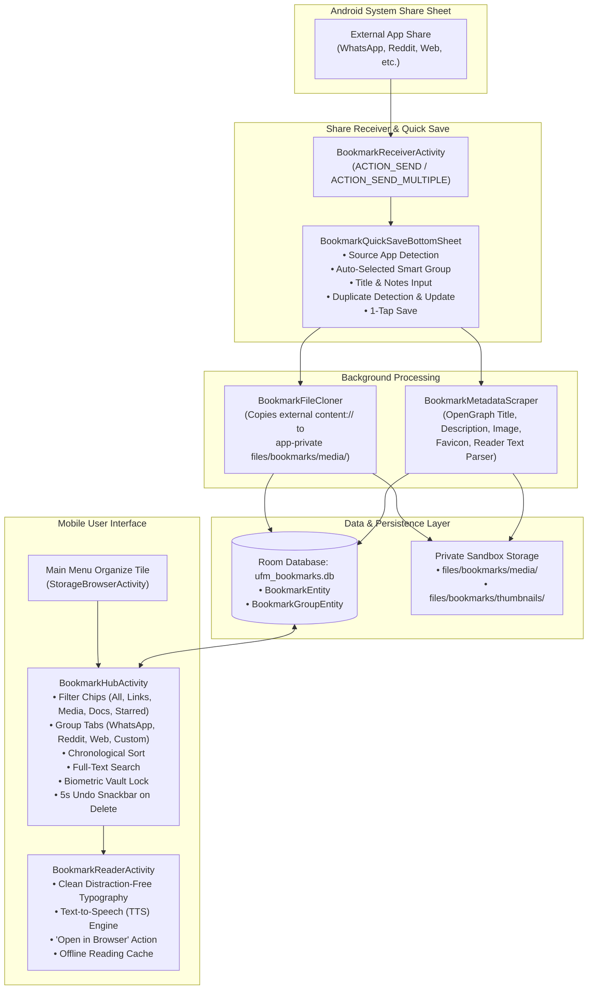

# Implementation Plan: Smart Bookmark Hub (Mobile Only)

## Goal Description
Implement the **Smart Bookmark Hub** for Ultimate File Manager Pro on mobile devices. The Bookmark Hub acts as a unified repository for shared links, media, files, and notes from external applications (WhatsApp, Reddit, YouTube, Twitter/X, Chrome, Telegram, Medium, etc.). 

It introduces a third dedicated system share sheet target—**"Bookmark with UFM"**—alongside the existing "Open In..." and "Save to..." targets. Bookmarks are automatically organized into smart source groups, preserved permanently inside the app's private sandbox (`context.filesDir/bookmarks/media/`), presented in a visual dashboard with OpenGraph previews and thumbnails, and equipped with a distraction-free reader view, text-to-speech audio reader, biometric group locking, and export capabilities.

The feature is accessible via a new tile in the Main Menu under the **"Organize"** category (`MainMenuViewModeManager.CATEGORY_ORGANIZE`) and is completely unrestricted with zero paywalls.

---

## User Review Required
> [!IMPORTANT]
> **Strict Application Directory Sandbox Storage**:
> All shared physical media, files, and downloaded thumbnails are stored strictly inside the application's internal private directory (`context.filesDir/bookmarks/media/` and `context.filesDir/bookmarks/thumbnails/`). 
> - External file explorers, MTP, and Android MediaStore scanner cannot see or index these files.
> - UFM's own general file browser and Recents list will explicitly ignore and not expose this directory.
> - Files can only be exported to public user storage if the user explicitly triggers "Save to Storage" from the bookmark card.

> [!NOTE]
> **Mobile Only Scope**:
> In accordance with the specification, all activities, layouts, and tile registrations are built exclusively for Android mobile/tablet devices (`!DeviceUtils.isTvDevice(context)`). Android TV menus and share receivers do not display or load this feature.

---

## Key Decisions from /clarify
1. **Default Tap Action on Links**: Tapping opens the **Distraction-Free Reader Mode** if readable article text is available, with a prominent button at the top to open in the user's external browser. If no readable article body exists, it launches directly in the external browser.
2. **Duplicate Detection**: Sharing an existing link or file updates the bookmark's timestamp (bumping it to the top) and appends any new notes, preventing clutter.
3. **Dynamic Auto-Grouping**: Shares from apps without predefined groups automatically create a new smart group titled after the app's display name (e.g., "Medium", "Threads", "Slack").
4. **Deletion**: Deletion is immediate with a 5-second **Undo Snackbar**; once the snackbar times out, private files in `files/bookmarks/media/` and `files/bookmarks/thumbnails/` are permanently purged.
5. **Private Sandbox Isolation**: Files remain strictly sandboxed in application storage and are invisible in standard file browsing unless explicitly exported via *"Save to Storage"*.

---

## Architecture & Data Flow



---

## Proposed Changes

### Component 1: Room Database & Data Models
Create the persistence layer for bookmarks and groups inside package `za.kilowatch.ultimatefilemanager.bookmarks.db`.

#### [NEW] [BookmarkEntity.kt](file:///F:/Share/UFM/app/src/main/java/za/kilowatch/ultimatefilemanager/bookmarks/db/BookmarkEntity.kt)
- Room entity for bookmarked items.
- Fields: `id`, `title`, `url`, `filePath`, `thumbnailPath`, `faviconPath`, `contentType`, `sourcePackage`, `sourceAppName`, `groupId`, `groupName`, `notes`, `cachedArticleText`, `fileSizeBytes`, `isStarred`, `isRead`, `isLocked`, `createdAt`, `updatedAt`.
- Indices on `groupId`, `contentType`, `sourcePackage`, `createdAt`, `isStarred`, `url`.

#### [NEW] [BookmarkGroupEntity.kt](file:///F:/Share/UFM/app/src/main/java/za/kilowatch/ultimatefilemanager/bookmarks/db/BookmarkGroupEntity.kt)
- Room entity for smart and custom groups.
- Fields: `id`, `name`, `iconResName`, `colorHex`, `isAutoGroup`, `associatedPackage`, `isLocked`, `sortOrder`, `createdAt`.

#### [NEW] [BookmarkDao.kt](file:///F:/Share/UFM/app/src/main/java/za/kilowatch/ultimatefilemanager/bookmarks/db/BookmarkDao.kt)
- Reactive DAO queries using Kotlin `Flow` and `suspend` functions:
  - `getAllBookmarks(sortOrder)`: Flow<List<BookmarkEntity>>
  - `getBookmarksByGroup(groupId, sortOrder)`: Flow<List<BookmarkEntity>>
  - `getBookmarksFiltered(groupId?, contentType?, isStarred?, query?, sortOrder)`: Flow<List<BookmarkEntity>>
  - `getBookmarkById(id)`: suspend fun
  - `getBookmarkByUrl(url)`: suspend fun (for duplicate detection)
  - `insertBookmark(item)`, `updateBookmark(item)`, `deleteBookmark(item)`
  - `getAllGroups()`: Flow<List<BookmarkGroupEntity>>
  - `getGroupByPackage(pkg)`: suspend fun
  - `getGroupById(id)`, `insertGroup(group)`, `updateGroup(group)`, `deleteGroup(group)`
  - `getBookmarkCount()`: Flow<Int>
  - `getGroupCount()`: Flow<Int>

#### [NEW] [BookmarkDatabase.kt](file:///F:/Share/UFM/app/src/main/java/za/kilowatch/ultimatefilemanager/bookmarks/db/BookmarkDatabase.kt)
- Room database instance (`ufm_bookmarks.db`, version 1, `exportSchema = false`).
- Companion singleton pattern matching `RecycleBinDatabase`.

#### [NEW] [BookmarkRepository.kt](file:///F:/Share/UFM/app/src/main/java/za/kilowatch/ultimatefilemanager/bookmarks/db/BookmarkRepository.kt)
- Repository coordinating database access, file operations, duplicate detection, and smart group provisioning.
- `ensureDefaultGroups()`: Automatically provisions default groups on first run:
  - WhatsApp (`com.whatsapp`)
  - Reddit (`com.reddit.frontpage`)
  - YouTube (`com.google.android.youtube`)
  - Twitter / X (`com.twitter.android`)
  - Web & Articles (Chrome/Browser)
  - Telegram (`org.telegram.messenger`)
  - Saved Files & Documents
- `getOrCreateGroupForPackage(pkg, appName)`: Dynamically creates new auto-groups for unrecognized apps.

---

### Component 2: Background Scraper & Sandbox Cloner
Create utilities for metadata extraction, offline article parsing, and file cloning inside `za.kilowatch.ultimatefilemanager.bookmarks.util`.

#### [NEW] [BookmarkFileCloner.kt](file:///F:/Share/UFM/app/src/main/java/za/kilowatch/ultimatefilemanager/bookmarks/util/BookmarkFileCloner.kt)
- Reads incoming `content://` or `file://` URIs and writes to `context.filesDir/bookmarks/media/` with secure UUID filenames and original extensions preserved.
- Generates image/video thumbnails and writes to `context.filesDir/bookmarks/thumbnails/`.
- Deletes associated physical files when a bookmark is deleted.

#### [NEW] [BookmarkMetadataScraper.kt](file:///F:/Share/UFM/app/src/main/java/za/kilowatch/ultimatefilemanager/bookmarks/util/BookmarkMetadataScraper.kt)
- Background coroutine utility to scrape OpenGraph metadata for URLs:
  - Connects using `HttpURLConnection` with desktop/mobile User-Agent.
  - Extracts `<meta property="og:title">`, `<meta property="og:description">`, `<meta property="og:image">`, `<link rel="icon">`.
  - Downloads cover image and favicon to `context.filesDir/bookmarks/thumbnails/`.
  - Extracts clean readable article body using readability container heuristic (strips ads, scripts, nav, footer) and caches text for offline reading.

---

### Component 3: Share Receiver & Quick Save Bottom Sheet
Create the external share handler and confirmation sheet inside `za.kilowatch.ultimatefilemanager.bookmarks.ui`.

#### [NEW] [BookmarkReceiverActivity.kt](file:///F:/Share/UFM/app/src/main/java/za/kilowatch/ultimatefilemanager/bookmarks/ui/BookmarkReceiverActivity.kt)
- Registered in `AndroidManifest.xml` with label `@string/share_target_bookmark` ("Bookmark with UFM").
- Accepts `ACTION_SEND` and `ACTION_SEND_MULTIPLE` for `text/*` and `*/*`.
- Extracts shared URLs, text, and stream URIs.
- Resolves sending package using `callingPackage` and package manager.
- Shows `BookmarkQuickSaveBottomSheet`.

#### [NEW] [BookmarkQuickSaveBottomSheet.kt](file:///F:/Share/UFM/app/src/main/java/za/kilowatch/ultimatefilemanager/bookmarks/ui/BookmarkQuickSaveBottomSheet.kt)
- Glassmorphism bottom sheet (`R.layout.bottom_sheet_bookmark_quick_save`).
- Displays:
  - Source app icon and label (e.g. "Shared from WhatsApp").
  - Content preview (thumbnail, title, link/file size).
  - Target group selector dropdown with auto-selected smart group.
  - Optional title edit and note input.
  - Duplicate check: If URL/file already exists, shows notice: *"Already bookmarked — will update note & move to top"*.
  - "Save Bookmark" primary button with auto-dismiss toast.

---

### Component 4: Bookmark Hub Main Screen
Create the main interface for browsing, searching, filtering, and managing bookmarks inside `za.kilowatch.ultimatefilemanager.bookmarks.ui`.

#### [NEW] [BookmarkHubActivity.kt](file:///F:/Share/UFM/app/src/main/java/za/kilowatch/ultimatefilemanager/bookmarks/ui/BookmarkHubActivity.kt)
- Main screen adhering to `UFMStandard`:
  - 56dp frosted glass toolbar with back button, title, search action, sort action, export action, and multi-select toggle.
  - Horizontal group tabs / chips (All, WhatsApp, Reddit, Web, Custom Groups, + Add Group).
  - Horizontal content type filter chips (All, Links, Media, Documents, Notes, Starred).
  - Sort menu (Newest to Oldest, Oldest to Newest, Title A-Z, Size).
  - Search bar with live reactive filtering.
  - Empty state with modern illustration and instructions.
- RecyclerView using `BookmarkAdapter`.
- Deletion flow: Immediate removal with 5-second **Undo Snackbar** before purging files from private storage.
- Long press multi-select mode:
  - Batch move to group.
  - Batch delete.
  - Batch export (HTML Netscape bookmarks / Markdown).
- Vault lock integration: Checks `isLocked` on group; invokes `BiometricPrompt` before displaying sensitive items.

#### [NEW] [BookmarkAdapter.kt](file:///F:/Share/UFM/app/src/main/java/za/kilowatch/ultimatefilemanager/bookmarks/ui/BookmarkAdapter.kt)
- Glassmorphism item cards (`R.layout.item_bookmark_card` and `R.layout.item_bookmark_card_grid`).
- Visual components:
  - OpenGraph cover image / file thumbnail loaded via Coil.
  - Title and domain / file size subtitle.
  - Source app badge icon.
  - Star toggle button.
  - Tap card: Opens Reader Mode if readable text cached; opens browser or UFM viewer otherwise.
  - 3-dot overflow menu: Open Original, Read Mode, Copy Link, Save to Storage (Export), Move, Delete.

---

### Component 5: Distraction-Free Reader Mode & Text-to-Speech
Create the article reader inside `za.kilowatch.ultimatefilemanager.bookmarks.ui`.

#### [NEW] [BookmarkReaderActivity.kt](file:///F:/Share/UFM/app/src/main/java/za/kilowatch/ultimatefilemanager/bookmarks/ui/BookmarkReaderActivity.kt)
- Pure typography reading screen (`R.layout.activity_bookmark_reader`):
  - Reading container with adjustable margins and line height.
  - Article title, domain, publication date, and clean body text.
  - Top header action: *"Open in Browser"* to open live URL in Chrome/browser.
  - Quick action toolbar:
    - Text size adjustment (A- / A+).
    - Font style toggle (Serif vs Sans).
    - Theme switcher: Light (Paper), Warm Sepia, Dark (OLED).
    - Star & Mark as Read toggles.
  - **Text-to-Speech (TTS) Player Bar**:
    - Android `TextToSpeech` integration.
    - Play / Pause / Stop controls.
    - Speed selector (0.75x, 1x, 1.25x, 1.5x, 2x).
    - Paragraph progress indicator.

---

### Component 6: Main Menu Tile & Registration Checklist

#### [MODIFY] [StorageItem.kt](file:///F:/Share/UFM/app/src/main/java/za/kilowatch/ultimatefilemanager/storage/StorageItem.kt)
- Add `val isBookmarkHubTile: Boolean = false`.
- Include `isBookmarkHubTile` in `isHideable` property.

#### [MODIFY] [StorageAdapter.kt](file:///F:/Share/UFM/app/src/main/java/za/kilowatch/ultimatefilemanager/storage/StorageAdapter.kt)
- In `categorizeItem()`, map `item.isBookmarkHubTile` to `MainMenuViewModeManager.CATEGORY_ORGANIZE`.

#### [MODIFY] [StorageBrowserActivity.kt](file:///F:/Share/UFM/app/src/main/java/za/kilowatch/ultimatefilemanager/storage/StorageBrowserActivity.kt)
- In `buildAllKnownTiles()`: Add `isBookmarkHubTile = true`.
- In `loadStorageVolumes()`: When `!DeviceUtils.isTvDevice(this)`, instantiate and add `StorageItem(id = "bookmark_hub_tile", label = getString(R.string.bookmark_hub_title), iconRes = R.drawable.ic_bookmark_hub, isBookmarkHubTile = true)`.
- In `getStorageSubtitle()`: Return formatted bookmark count.
- In tile click router: Launch `BookmarkHubActivity`.

#### [MODIFY] [TileOrderManager.kt](file:///F:/Share/UFM/app/src/main/java/za/kilowatch/ultimatefilemanager/storage/TileOrderManager.kt)
- Include `isBookmarkHubTile` in `isFeatureTile()` check.

#### [MODIFY] [IconCustomizationManager.kt](file:///F:/Share/UFM/app/src/main/java/za/kilowatch/ultimatefilemanager/util/IconCustomizationManager.kt)
- Add `R.drawable.ic_bookmark_hub` to `ALL_BUILTIN_ICONS`.

#### [NEW] [ic_bookmark_hub.xml](file:///F:/Share/UFM/app/src/main/res/drawable/ic_bookmark_hub.xml)
- Vector drawable icon for Bookmark Hub.

#### [MODIFY] [strings.xml](file:///F:/Share/UFM/app/src/main/res/values/strings.xml)
- Add all required localized strings:
  - `bookmark_hub_title` ("Smart Bookmarks")
  - `bookmark_hub_subtitle` ("Organize saved links, media & shares")
  - `share_target_bookmark` ("Bookmark with UFM")
  - Group names, filter chips, reader mode labels, TTS controls, and export options.

#### [MODIFY] [AndroidManifest.xml](file:///F:/Share/UFM/app/src/main/AndroidManifest.xml)
- Register `BookmarkReceiverActivity` with `ACTION_SEND` and `ACTION_SEND_MULTIPLE`.
- Register `BookmarkHubActivity` and `BookmarkReaderActivity`.

---

## Verification Plan

### Automated Build Verification
1. **Compilation Check**:
   ```powershell
   ./gradlew assembleDebug
   ```
2. **Room KSP Verification**:
   Verify Room compiler generates DAO and database classes cleanly.

### Manual Verification
1. **Share Sheet Target**:
   - Share URL from browser -> verify "Bookmark with UFM" appears and opens Quick Save bottom sheet.
   - Share Reddit post -> verify auto-detected "Reddit" group.
   - Share WhatsApp media -> verify auto-detected "WhatsApp" group and physical media cloned into `files/bookmarks/media/`.
2. **Sandbox Isolation**:
   - Verify files inside `context.filesDir/bookmarks/media/` are not visible in UFM's general file browser or gallery.
   - Delete original photo in WhatsApp -> verify bookmark in UFM Bookmark Hub remains fully playable and intact.
3. **Organize Tile**:
   - Open UFM Main Menu on mobile -> scroll to "Organize" category -> verify "Smart Bookmarks" tile appears.
   - Tap tile -> opens `BookmarkHubActivity`.
4. **Sorting & Filtering**:
   - Tap "Links" / "Media" / "Docs" filter chips -> items filter accordingly.
   - Test "Newest to Oldest" vs "Oldest to Newest" chronological sort.
5. **Reader Mode & TTS**:
   - Open a bookmarked article in Reader View -> verify clean typography.
   - Tap TTS Play button -> verify Android reads aloud at various speeds (1x, 1.5x).
6. **Vault Lock**:
   - Lock a bookmark group -> verify biometric/PIN prompt appears.
7. **Export**:
   - Export bookmarks to HTML -> import into Chrome -> verify bookmarks import cleanly.
