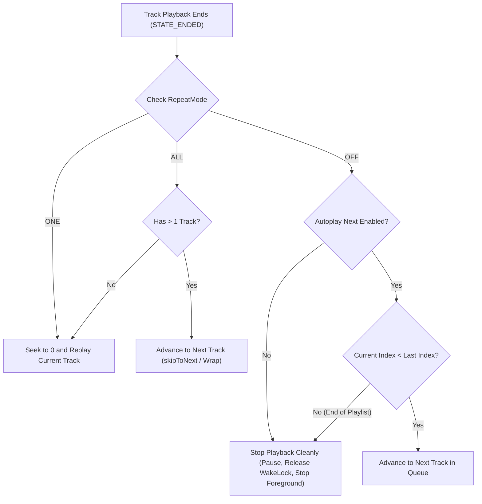

# Implementation Plan: UFM Media Player Loop and Continuous Playback Control

## Goals
Implement precise playback control in UFM Media Player to resolve issues reported in `error.txt`:
1. Prevent unintended repeating and continuous auto-advance by strictly honoring the "Auto-play next in UFM Player" setting (`AutoplayPreferenceManager`).
2. Replace the binary repeat toggle with a robust 3-state Repeat Mode (`RepeatMode.OFF`, `RepeatMode.ALL`, `RepeatMode.ONE`).
3. Ensure that when Auto-play Next is disabled, opening an audio or video file plays that file once and stops automatically upon completion.
4. Guarantee that when Auto-play Next is enabled with Repeat Off, reaching the end of the playlist stops playback cleanly without wrapping around to track 1.
5. Provide seamless Mobile and Android TV parity with distinct iconography, D-pad control, and HUD toast announcements.
6. Persist user playback mode preferences globally across sessions and restarts.

---

## Architecture Overview



### Key Components:
1. **Preferences Layer (`PlayerPreferencesManager.kt`)**:
   - Introduce `RepeatMode` enum (`OFF`, `ALL`, `ONE`).
   - Manage `player_repeat_mode` key in `ufm_player_prefs` SharedPreferences.
   - Default mode is `RepeatMode.OFF`.
   - Provide `cycleRepeatMode()` helper to transition `OFF` → `ALL` → `ONE` → `OFF`.
2. **Playback Engine (`UFMPlaybackService.kt`)**:
   - Bind `repeatMode` state directly to `PlayerPreferencesManager`.
   - In `Player.Listener.onPlaybackStateChanged(STATE_ENDED)`:
     - Check `AutoplayPreferenceManager.isEnabled(this)`.
     - Route strictly according to active `RepeatMode` and autoplay status.
     - Release audio focus, wake locks, and foreground notification when stopping.
   - Provide `cycleRepeatMode(): RepeatMode` service binder method.
3. **Player UI Controller (`UFMPlayerActivity.kt`)**:
   - Synchronize `btnRepeat` state:
     - `OFF`: `ic_repeat` with inactive alpha (`0.4f` mobile / `0.5f` TV).
     - `ALL`: `ic_repeat` with active alpha (`1.0f`).
     - `ONE`: `ic_repeat_one` with active alpha (`1.0f`).
   - Suppress `NextTrackOverlayView` countdown when auto-play next is disabled or `RepeatMode.ONE` is active.
   - Display HUD toasts on mode changes (`player_toast_repeat_off`, `player_toast_repeat_all`, `player_toast_repeat_one`).
4. **Drawables & Icon Palette Registry**:
   - Add new Material vector drawable `ic_repeat_one.xml` (arrows with "1" numeral).
   - Register `ic_repeat_one` in `IconCustomizationManager.kt`, `IconCustomizationActivity.kt`, `IconPackExportActivity.kt`, and `strings.xml`.
5. **Strings & Localization Verification**:
   - Add string resources: `player_toast_repeat_all`, `player_toast_repeat_one`, `icon_media_repeat_one`.

---

## Files to Create

### `app/src/main/res/drawable/ic_repeat_one.xml`
- **What**: Material vector drawable (24x24dp) representing "Repeat One" (standard looping arrows with numeral "1" enclosed).
- **Key details**: Uses `#FFFFFFFF` fill color matching `ic_repeat.xml` and vector path `M7,7h10v3l4,-4 -4,-4v3H5v6h2V7zm10,10H7v-3l-4,4 4,4v-3h12v-6h-2v4zm-4,-2V9h-1l-2,1v1h1.5v4H13z`.

---

## Files to Modify

### `app/src/main/java/za/kilowatch/ultimatefilemanager/settings/PlayerPreferencesManager.kt`
- **What**: Add `RepeatMode` enum and preference getters/setters/cycle methods.
- **Key details**:
  ```kotlin
  enum class RepeatMode(val value: String) {
      OFF("off"),
      ALL("all"),
      ONE("one");

      companion object {
          fun fromValue(value: String): RepeatMode =
              entries.firstOrNull { it.value == value } ?: OFF
      }
  }
  ```
  - `KEY_REPEAT_MODE = "player_repeat_mode"`
  - `getRepeatMode(context: Context): RepeatMode` (default `RepeatMode.OFF`)
  - `setRepeatMode(context: Context, mode: RepeatMode)`
  - `cycleRepeatMode(context: Context): RepeatMode`

### `app/src/main/java/za/kilowatch/ultimatefilemanager/viewer/UFMPlaybackService.kt`
- **What**: Connect `repeatMode` and `AutoplayPreferenceManager` to playback termination and track progression.
- **Key details**:
  - Replace `var isRepeat: Boolean` with `var repeatMode: RepeatMode = RepeatMode.OFF`. Provide `val isRepeat: Boolean get() = repeatMode != RepeatMode.OFF` for backward compatibility.
  - In `onCreate()`, initialize `repeatMode = PlayerPreferencesManager.getRepeatMode(this)`.
  - Add `fun cycleRepeatMode(): RepeatMode` calling `PlayerPreferencesManager.cycleRepeatMode(this)`.
  - In `playerListener.onPlaybackStateChanged(state == Player.STATE_ENDED)`:
    - Read `AutoplayPreferenceManager.isEnabled(this)`.
    - If `RepeatMode.ONE`: Replay current track (seek 0 + play).
    - If `RepeatMode.ALL`: If queue size > 1, call `skipToNext()` (which wraps around); if queue size == 1, seek 0 + play.
    - If `RepeatMode.OFF`:
      - If autoplay is disabled or `skipAutoplayOnce` is true: call `pause()` and `safeStopForeground(true)`.
      - If autoplay is enabled:
        - If `queueManager.currentIndex < queueManager.size - 1`: call `skipToNext()`.
        - Else (last track in playlist reached): call `pause()` and `safeStopForeground(true)` cleanly.

### `app/src/main/java/za/kilowatch/ultimatefilemanager/viewer/UFMPlayerActivity.kt`
- **What**: Update repeat button display, click handler, and next-track overlay countdown gating.
- **Key details**:
  - Add `updateRepeatButton(mode: RepeatMode)`:
    - `RepeatMode.OFF`: sets `ic_repeat`, alpha inactive (`0.4f` mobile / `0.5f` TV).
    - `RepeatMode.ALL`: sets `ic_repeat`, alpha active (`1.0f`).
    - `RepeatMode.ONE`: sets `ic_repeat_one`, alpha active (`1.0f`).
  - In `btnRepeat.setOnClickListener`:
    - Call `val newMode = playbackService?.cycleRepeatMode() ?: PlayerPreferencesManager.cycleRepeatMode(this)`.
    - Call `updateRepeatButton(newMode)`.
    - Show HUD toast using `PlayerToastHelper.show(this, getString(toastRes))`.
  - In `playbackCallback.onServiceConnected`: sync button with `playbackService.repeatMode`.
  - In `updateProgressRunnable`: Gated check for `nextTrackOverlay`:
    - Do not show next track countdown if `!AutoplayPreferenceManager.isEnabled(this)` or `repeatMode == RepeatMode.ONE` or `(repeatMode == RepeatMode.OFF && queue.currentIndex >= queue.size - 1)`.

### `app/src/main/java/za/kilowatch/ultimatefilemanager/settings/IconCustomizationManager.kt`
- **What**: Register `R.drawable.ic_repeat_one` in `ALL_BUILTIN_ICONS`.

### `app/src/main/java/za/kilowatch/ultimatefilemanager/settings/IconCustomizationActivity.kt`
- **What**: Register `IconItemData("media_repeat_one", ...)` in Media category.

### `app/src/main/java/za/kilowatch/ultimatefilemanager/settings/IconPackExportActivity.kt`
- **What**: Add `"media_repeat_one"` to `loadCategories()`.

### `app/src/main/res/values/strings.xml`
- **What**: Add string resources for repeat mode announcements and icon registry.
- **Key details**:
  - `<string name="player_toast_repeat_all">Repeat all</string>`
  - `<string name="player_toast_repeat_one">Repeat current track</string>`
  - `<string name="icon_media_repeat_one">Repeat One</string>`

### `app/src/test/java/za/kilowatch/ultimatefilemanager/viewer/RepeatModeTest.kt`
- **What**: Unit test for `RepeatMode` enum values, transitions, and cycling logic.

---

## Data Model
- New Enum:
  ```kotlin
  enum class RepeatMode(val value: String) {
      OFF("off"),
      ALL("all"),
      ONE("one");
  }
  ```
- SharedPreferences key in `ufm_player_prefs`:
  - `"player_repeat_mode"`: String value (`"off"`, `"all"`, or `"one"`), default `"off"`.

---

## Dependencies
- No new external dependencies required. Uses existing AndroidX Media3 ExoPlayer, SharedPreferences, and Material Components.

---

## Test Plan

### Automated Tests
1. **Unit Test Execution**:
   ```bash
   ./gradlew testMobileGoogleDebugUnitTest --tests "za.kilowatch.ultimatefilemanager.viewer.RepeatModeTest"
   ./gradlew testMobileGoogleDebugUnitTest --tests "za.kilowatch.ultimatefilemanager.viewer.QueueManagerTest"
   ```
2. **Translation Verification**:
   ```bash
   python -u translate_strings.py verify
   ```
3. **Compilation Check**:
   ```bash
   ./gradlew assembleMobileGoogleDebug
   ```

### Manual Verification
1. **Single File Play Once (The core bug in error.txt)**:
   - Ensure "Auto-play next in UFM Player" is Disabled in Settings.
   - Open an audio file in a folder containing multiple tracks.
   - Fast-forward to near the end and let it play to completion.
   - **Verify**: Playback stops completely; service releases audio focus; notification disappears/idles; subsequent tracks DO NOT play; current track DOES NOT repeat.
2. **Repeat Cycle**:
   - In UFM Player, tap Repeat button once: verify toast "Repeat all" and icon is active `ic_repeat`.
   - Tap Repeat button again: verify toast "Repeat current track" and icon switches to `ic_repeat_one`.
   - Tap Repeat button third time: verify toast "Repeat off" and icon returns to dimmed `ic_repeat`.
3. **Repeat One Verification**:
   - Set Repeat to "Repeat current track".
   - Let track reach the end.
   - **Verify**: Same track automatically restarts from 0:00 and continues playing.
4. **Repeat All Verification**:
   - Set Repeat to "Repeat all", Auto-play to Enabled.
   - At end of last track in playlist, verify it wraps back to track 1 and continues.
5. **Repeat Off with Auto-play Enabled**:
   - Set Repeat to "Repeat off", Auto-play to Enabled.
   - Let tracks play: track 1 advances to track 2, etc.
   - At the end of the last track in the playlist, verify playback stops and does not loop back to track 1.
6. **Android TV Parity**:
   - Test Repeat button focus and cycling on Android TV with D-pad remote.
   - Verify TV HUD toast appears on each press.

---

## Risks & Mitigations
- **Risk**: Stale in-memory playback service state when user changes Autoplay setting in Settings.
  - **Mitigation**: `UFMPlaybackService` reads `AutoplayPreferenceManager.isEnabled(this)` dynamically on track completion rather than caching a static boolean at launch.
- **Risk**: Legacy components expecting `isRepeat: Boolean`.
  - **Mitigation**: Provide backward-compatible computed property `val isRepeat: Boolean get() = repeatMode != RepeatMode.OFF`.
