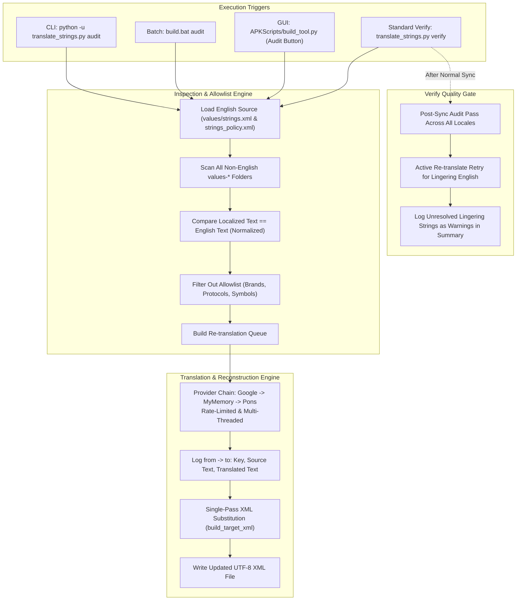

# Implementation Plan: Translation English String Inspection, Re-translation & Verification Engine

## Goals
Enable automated detection, re-translation, and post-sync verification of untranslated English strings across all non-English Android localization files (`res/values-*/strings.xml`, `strings_policy.xml`), with full `from -> to` logging, `build.bat` support, and build tool GUI integration. Satisfies all functional requirements in [spec.md](file:///F:/Share/UFM/.plans/spec.md) and confirmed decisions in [clarifications.md](file:///F:/Share/UFM/.plans/clarifications.md).

---

## Architecture Overview



---

## Files to Modify

### `translate_strings.py` — Core Translation & Verification Script
- **What:** Add allowlist, English detection heuristics, audit mode (`run_audit_mode()`), post-translation verify gate (`run_verify_mode()`), and `from -> to` transformation logging.
- **Key details:**
  - Define `ALLOWLIST_EXEMPT_STRINGS` set (brands, cloud backends, protocols, symbols, proper nouns).
  - Add `is_string_exempt(raw_text, name=None) -> bool`.
  - Add `detect_english_strings_in_file(english_text, localized_text) -> (strings_to_fix, arrays_to_fix)`.
  - Implement `run_audit_mode()`:
    - Iterates over all 18+ `values-*` directories.
    - Inspects `strings.xml` and `strings_policy.xml`.
    - Batches detected English strings and re-translates them via the fallback chain.
    - Prints `[{lang}] [{file}:{key}] from -> to: "{en_text}" -> "{translated_text}"`.
    - Replaces only verified non-English results using single-pass XML substitution.
    - Prints statistical summary report.
  - Enhance `run_verify_mode()`:
    - After standard synchronization completes, runs a verification audit across all non-English files.
    - Automatically executes an active re-translation retry pass for any lingering English strings.
    - Reports any remaining unresolved entries as warnings in the final summary.
  - Update `main()` to route `sys.argv[1] == 'audit'` to `run_audit_mode()`, and add choice in interactive mode.

### `build.bat` — Windows Build Script
- **What:** Add CLI parameter handling for `audit`.
- **Key details:**
  - Check `%1` for `audit`, `--audit-translations`, or `-audit`.
  - If present, jump to `:run_audit` to execute `python -u translate_strings.py audit` and exit.
  - If omitted, proceed to launch `python APKScripts\build_tool.py` as normal.

### `APKScripts/build_tool.py` — Desktop Build Tool GUI
- **What:** Add **"🔄 Audit & Fix English Strings"** button to Translations tab.
- **Key details:**
  - In `_build_translations_tab()`, add `self.trans_audit_btn` in the actions row.
  - In `_run_translation_cmd()`, disable `self.trans_audit_btn` during active tasks.
  - In `_on_translation_finished()`, re-enable `self.trans_audit_btn`.
  - Implement `_on_trans_audit_clicked()` dispatching `translate_strings.py` with `["audit"]`.

---

## Data Model
In-memory audit data structure:
```python
{
    "locales_inspected": int,
    "files_scanned": int,
    "total_english_detected": int,
    "total_retranslated": int,
    "total_exempt_skipped": int,
    "unresolved_failures": {
        "es": ["key_1", "key_2"],
        "de": [...]
    }
}
```
No database migrations, Room schemas, or SharedPreferences changes are required.

---

## Dependencies
- Standard Python libraries: `os`, `sys`, `xml.etree.ElementTree`, `re`, `json`, `hashlib`, `threading`, `concurrent.futures`, `time`.
- Third-party packages (already installed): `deep_translator` (`GoogleTranslator`, `MyMemoryTranslator`, `PonsTranslator`), `customtkinter`, `questionary`.

---

## Test Plan
1. **Exemption Logic Test**:
   - Verify allowlist returns `True` for `"Ultimate File Manager Pro"`, `"Google Drive"`, `"SMB"`, `"%s"`, `"OK"`.
   - Verify allowlist returns `False` for `"Select all items in folder"`, `"Storage Settings"`.
2. **Audit & Re-translate Execution**:
   - Run `python -u translate_strings.py audit`.
   - Verify `from -> to` logs appear for every re-translated string.
   - Verify XML files in `values-*/strings.xml` are updated cleanly without breaking XML tags or escaping.
3. **Verify Quality Gate**:
   - Run `python -u translate_strings.py verify`.
   - Verify post-translation audit executes and reports remaining English strings.
4. **Batch Script Test**:
   - Run `build.bat audit` from terminal and verify direct CLI console execution.
5. **Build Tool GUI Test**:
   - Launch `build.bat` without arguments, verify the new button is present, enabled, and functions correctly.
6. **Gradle Build Verification**:
   - Run `./gradlew assembleMobileGoogleDebug` to confirm no XML or AAPT errors exist.

---

## Risks & Mitigations
- **Risk:** Translation APIs (Google/MyMemory/Pons) rate limiting or returning HTTP 429 during large batch audit.  
  **Mitigation:** Built-in rate limiter (`_rate_limited_call`) with exponential backoff and retry mechanism, plus in-memory session cache.
- **Risk:** Legitimate identical words (e.g., "Menu", "Audio" in Spanish) falsely re-translated endlessly.  
  **Mitigation:** Allowlist for known technical/brand words, check against normalized English, and skip if re-translation produces identical text.
- **Risk:** Accidental malformed XML or unescaped quotes in translated output.  
  **Mitigation:** Retain existing `escape_text_nodes()` and `build_target_xml()` single-pass substitution engine that preserves XML formatting.
