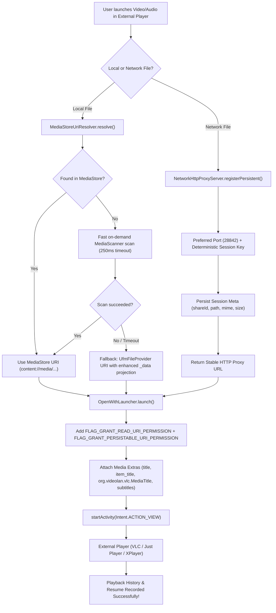

# Implementation Plan: External Video Player Playback History Tracking (Issue #67)

## Goals
Ensure that video and audio files launched from UFM into external media players (such as VLC for Android, Just Player, Next Player, MPV, Nova Video Player, MX Player, and XPlayer) are properly recognized, indexed, and recorded in the external player's playback history and resume database. Enable external players to reopen and resume local media and remote network streams directly from their history tabs.

Reference Spec & Clarification Criteria:
- Local video and audio files prioritize Android system `MediaStore` content URIs (`content://media/external/.../<id>`) when launched into external players, allowing players with standard `READ_MEDIA_VIDEO` / `READ_MEDIA_AUDIO` permissions (like VLC using `libmedialibrary`) to index and track playback history.
- Freshly created or unindexed local media triggers a fast on-demand scan via `MediaScannerConnection` (with a ~250ms timeout budget) before launching, falling back cleanly to `UfmFileProvider` if the scan times out or fails.
- `UfmFileProvider` query projections are enhanced to return `_data`, `_id`, `_display_name`, `_size`, and metadata columns robustly for all storage locations.
- `FLAG_GRANT_PERSISTABLE_URI_PERMISSION` is granted alongside `FLAG_GRANT_READ_URI_PERMISSION` to allow external players' history databases to retain read authorization across device reboots without requiring any Play Console policy declarations.
- Network & cloud streams served by `NetworkHttpProxyServer` bind to a consistent preferred port and implement persistent session metadata with dynamic session revival, allowing external players to reopen and resume network streams from their history tab.

---

## Architecture Overview



### Architectural Decisions

1. **Extract Dedicated `MediaStoreUriResolver`**:
   - Centralize all MediaStore lookup and on-demand indexing logic in `za.kilowatch.ultimatefilemanager.viewer.openwith.MediaStoreUriResolver`.
   - Checks `MediaStore.Video.Media` for video files and `MediaStore.Audio.Media` for audio files.
   - Handles on-demand scanner completion using Kotlin coroutines `withTimeoutOrNull(250L)`.

2. **Enhance `UfmFileProvider` Projections**:
   - Ensure `_id`, `_data`, `_display_name`, `_size`, `title`, `mime_type`, and `date_modified` are correctly populated for all mounted storage types (internal, SD card, root, and cache).
   - Prevents null pointer or missing column crashes in 3rd party players querying provider cursors.

3. **Attach Persistable URI Permissions**:
   - In `OpenWithLauncher.launch()` and `launchSystemChooser()`, add `Intent.FLAG_GRANT_PERSISTABLE_URI_PERMISSION` to intent flags and `grantUriPermission()`.
   - Wrap in graceful fallback so providers that reject persistable grants don't interrupt intent dispatching.

4. **Network Streaming Persistent Session Revival in `NetworkHttpProxyServer`**:
   - Bind preferred port `28842` (with fallback to ephemeral `0` if occupied) to ensure URLs stay stable across app lifecycles.
   - Maintain a lightweight persistent session cache in `context.filesDir/proxy_streaming_sessions.json`.
   - In `handleClient()`, if an incoming request contains a valid session key but the in-memory session was evicted or the app restarted, automatically query `NetworkShareRepository`, re-create the session, and resume streaming without returning 404.

---

## Files to Create

### `app/src/main/java/za/kilowatch/ultimatefilemanager/viewer/openwith/MediaStoreUriResolver.kt` — MediaStore Content URI Resolver
- **What:** Resolves local file paths to system `MediaStore` content URIs for video and audio files, with fast on-demand scanning for unindexed files.
- **Key details:**
  - `fun resolve(context: Context, file: File, mimeType: String? = null, timeoutMs: Long = 250L): Uri?`
  - Direct database query against `MediaStore.Video.Media.EXTERNAL_CONTENT_URI` / `MediaStore.Audio.Media.EXTERNAL_CONTENT_URI` using `MediaStore.MediaColumns.DATA = ?`.
  - On-demand `MediaScannerConnection.scanFile` fallback with non-blocking timeout.

### `app/src/test/java/za/kilowatch/ultimatefilemanager/viewer/openwith/MediaStoreUriResolverTest.kt` — Unit Tests
- **What:** Unit tests for `MediaStoreUriResolver` verifying query filtering, non-media exclusion, root path exclusion, and timeout handling.

---

## Files to Modify

### `app/src/main/java/za/kilowatch/ultimatefilemanager/viewer/openwith/OpenWithManager.kt` — Entry Point URI Resolution
- **What:** Update `OpenWithManager.show()` to resolve MediaStore URIs for local video and audio files before falling back to `FileProvider`.
- **Key details:**
  - Call `MediaStoreUriResolver.resolve(...)` when file is a local media file.
  - Retain existing SAF document URI handling for SAF-only files.

### `app/src/main/java/za/kilowatch/ultimatefilemanager/viewer/FileViewerRouter.kt` — External Open Flow
- **What:** Update `openWithExternalApp()` to pass resolved MediaStore URIs to `OpenWithManager.show()`.
- **Key details:**
  - Ensure direct taps (with remembered external defaults) and dialog selections use the MediaStore URI.

### `app/src/main/java/za/kilowatch/ultimatefilemanager/viewer/openwith/OpenWithLauncher.kt` — Permission Grants & Flags
- **What:** Add `FLAG_GRANT_PERSISTABLE_URI_PERMISSION` to intent flags and `grantUriPermission()` calls.
- **Key details:**
  - Safely handle `SecurityException` if a specific provider or device denies persistable grants.

### `app/src/main/java/za/kilowatch/ultimatefilemanager/storage/UfmFileProvider.kt` — Provider Query Enhancement
- **What:** Add `_id` and ensure `_data` and metadata columns resolve accurately for all storage locations.

### `app/src/main/java/za/kilowatch/ultimatefilemanager/network/NetworkHttpProxyServer.kt` — Persistent Sessions & Preferred Port
- **What:** Add preferred port binding (28842), session metadata persistence to disk, and dynamic on-demand session revival when requests arrive for evicted sessions.
- **Key details:**
  - `PREFERRED_PORT = 28842`
  - Persist session map `{key -> ShareId, path, mime, size, authToken}` in `proxy_streaming_sessions.json`.
  - In `handleClient()`, resurrect session on demand via `NetworkShareRepository` if missing from in-memory cache.

### `app/src/test/java/za/kilowatch/ultimatefilemanager/network/NetworkHttpProxyServerTest.kt` — Streaming Proxy Tests
- **What:** Add unit test for persistent session revival and deterministic key recreation.

---

## Data Model
New persistent session data structure for proxy streaming:
```kotlin
data class PersistentProxySession(
    val key: String,
    val shareId: String,
    val path: String,
    val mimeType: String,
    val fileSize: Long,
    val authToken: String,
    val updatedAt: Long = System.currentTimeMillis()
)
```

---

## Dependencies
- Standard Android Framework `MediaStore`, `ContentUris`, `MediaScannerConnection`.
- No new 3rd-party libraries needed. Zero DEX overhead.

---

## Test Plan

### Unit Tests
- `MediaStoreUriResolverTest`:
  - Returns `null` for non-media extensions (e.g. `.txt`, `.pdf`, `.zip`).
  - Returns `null` for non-existent or root/app-private paths.
  - Queries correct collection (Video vs Audio).
- `NetworkHttpProxyServerTest`:
  - Verifies session revival from persistent metadata when in-memory session is removed.
  - Verifies deterministic auth token and URL generation.

### Manual Verification
1. **Local Video in VLC**:
   - Open a video in UFM using VLC.
   - Exit playback after playing for 10 seconds.
   - Open VLC -> History tab. Verify the video appears with its filename and resume timestamp.
2. **Local Video in XPlayer / Just Player**:
   - Open in XPlayer / Just Player. Verify history is recorded.
3. **Local Audio in VLC / Poweramp**:
   - Open an audio file in VLC. Verify audio playback history is recorded.
4. **Network Streaming from History**:
   - Play a video from SMB / WebDAV share in VLC via UFM.
   - Close UFM.
   - Open VLC -> History tab -> tap the streamed video. Verify it reconnects and plays without a 404 error.

---

## Risks & Mitigations
- **Risk:** `MediaScannerConnection.scanFile` takes too long on congested storage.
  - **Mitigation:** Use strict `withTimeoutOrNull(250)` coroutine timeout; immediately fall back to `UfmFileProvider` if the budget expires.
- **Risk:** Port 28842 is already occupied by another service on the device.
  - **Mitigation:** Attempt port 28842 with a `try-catch`; if a `BindException` occurs, cleanly fall back to `ServerSocket(0)` (dynamic port).
- **Risk:** `FLAG_GRANT_PERSISTABLE_URI_PERMISSION` fails on private FileProvider URIs.
  - **Mitigation:** Nested try-catch in `grantUriPermission()` so failures are caught and standard read/write permissions remain active.
