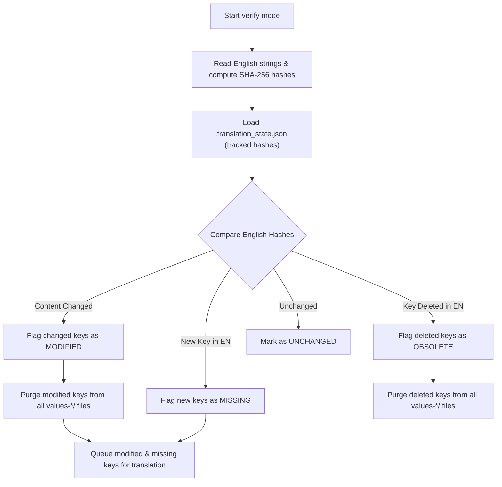
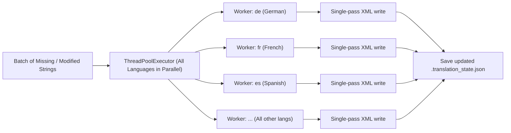

# Specification: High-Performance Optimization & English Change Tracking for `translate_strings.py`

## Overview
The Android localization synchronization tool `translate_strings.py` verifies and synchronizes localized Android XML strings across 17+ languages (`app/src/main/res/values-*`) against the canonical English source files (`strings.xml` and `strings_policy.xml`).

Currently, running `python -u translate_strings.py verify` suffers from three critical architectural deficiencies:
1. **Severe Execution Delay (5–6+ minutes even when up to date):** Caused by an $O(N \times M)$ repeated regex substitution loop where each of the 2,000+ strings sequentially triggers a whole-file regex recompilation and 250 KB string re-allocation (`replace_string_block`), taking ~18.8 seconds per language file.
2. **Sequential Language Processing:** Languages are evaluated and translated one-by-one in a blocking linear loop rather than running concurrently across languages when changes are detected.
3. **Inability to Detect English Source Content Modifications:** If an existing English string's text is edited (without changing its key name), `verify` assumes the translation is already present in `values-<lang>` and fails to update it. Stale translations persist indefinitely unless manually spotted, violating the project's string update rule.

This specification defines the architectural enhancements to:
- Implement a **source checksum tracking engine** (`.translation_state.json`) that detects newly modified English strings, automatically removes outdated translations across all languages, and triggers re-translation.
- Execute **parallel multi-language translation** using a concurrent worker pool when changes/missing strings are detected.
- Implement a **single-pass XML substitution engine** and fast set-difference bypass, cutting up-to-date verification from 5+ minutes to **under 1.5 seconds**.

---

## User Stories

- **US-01 (English Modification Tracking & Auto-Invalidation):** As a developer editing an existing English string, I want the translation tool to automatically detect that the English content has changed, purge the obsolete translated string from all `values-*/` directories, and queue it for re-creation/re-translation across all languages.
- **US-02 (Concurrent Multi-Language Execution):** As a developer syncing changes across 17 languages, I want all languages with detected changes to process and translate in parallel rather than sequentially, dramatically slashing total wall-clock runtime.
- **US-03 (Instant Verification for Clean Repositories):** As a developer running `verify` when no changes exist, I want the script to check checksums and key sets in sub-second time (< 1.5 s) and exit immediately without rebuilding files.
- **US-04 (High-Speed Single-Pass XML Generation):** As a developer re-creating localized XML files, I want the file rebuilder to assemble all strings in a single linear pass ($O(N)$) instead of thousands of regex substitutions over the file buffer.
- **US-05 (Automatic Pruning of Deleted Keys):** As a project maintainer, I want keys deleted from English to be automatically pruned from all localized files, adhering strictly to the `AGENTS.md` Translation Cleanup Rule.
- **US-06 (Strict Formatting & Tag Fidelity):** As an Android developer, I want all placeholders (`%s`, `%d`, `%1$s`), HTML tags (`<b>`, `<i>`), CDATA sections, and Android escapes (`\'`, `\"`, `\n`) to be preserved without syntax corruption.

---

## Architecture & Workflows

### 1. English Source Tracking & Change Detection Flow


### 2. Multi-Language Parallel Execution Flow


---

## Functional Requirements

### 1. Source Tracking & Change Invalidation (`.translation_state.json`)
- **FR-01 (Tracking Manifest Storage):**
  - Store English string checksums in a persistent JSON state file located at `app/src/main/res/.translation_state.json`.
  - Format:
    ```json
    {
      "version": 1,
      "files": {
        "strings.xml": {
          "string_key_name": "sha256_hash_of_english_content",
          ...
        },
        "strings_policy.xml": { ... }
      }
    }
    ```
- **FR-02 (Modification Detection):**
  - If a key exists in both English and `.translation_state.json`, but the SHA-256 hash of its inner content differs, flag the key as **MODIFIED**.
- **FR-03 (Cross-Language Auto-Purge of Modified Strings):**
  - For every key flagged as **MODIFIED**, immediately remove its entry from all existing localized files (`values-*/strings.xml`), ensuring stale translations are not retained.
  - Automatically add the key to the re-translation queue for all languages.
- **FR-04 (Cross-Language Pruning of Obsolete/Deleted Strings):**
  - For any key that exists in `.translation_state.json` or localized files but is no longer present in the English source, permanently prune it from all target files per `AGENTS.md`.
- **FR-05 (State Update on Completion):**
  - Once translation and file generation succeed, update `.translation_state.json` with the current English hashes so subsequent runs recognize them as up to date.

### 2. Concurrent Multi-Language Execution
- **FR-06 (Parallel Language Processing):**
  - When missing or modified strings are detected across languages, execute language synchronization concurrently using a worker pool (`ThreadPoolExecutor(max_workers=min(16, len(target_langs)))`).
  - Each thread owns a distinct language directory (`values-<lang>`), guaranteeing thread-safe, independent file I/O with zero cross-language lock contention.
- **FR-07 (Thread-Safe Logging):**
  - Implement a synchronized output lock (`tprint`) to prevent interleaved console logs when multiple languages run simultaneously.

### 3. High-Performance XML Reassembly (Single-Pass Engine)
- **FR-08 (Fast Path No-Op Bypass):**
  - If a language has zero missing strings, zero modified strings, and zero obsolete strings, bypass file rebuilding entirely. Verification for that language completes in < 5 ms.
- **FR-09 (Single-Pass Regex Substitution):**
  - When re-creating or updating a localized XML file, perform a single `re.sub(pattern, replacer, english_template)` pass in $O(N)$ time.
  - Look up translations directly from a pre-computed dictionary in $O(1)$ memory time rather than rescanning the whole file for every string.
  - File reconstruction time per language must drop from ~18.8 seconds to **< 35 milliseconds**.
- **FR-10 (String-Array Preservation):**
  - Reconstruct `<string-array>` items in a single pass per array without whole-file slicing loops.

### 4. Translation & Network Efficiency
- **FR-11 (Batch Translation):**
  - Group translatable plain text strings into batches (`GoogleTranslator.translate_batch` or batched delimited payloads) to minimize network roundtrips.
- **FR-12 (Translation Fallback Chain):**
  - Maintain robust multi-provider fallback: `GoogleTranslator` -> `MyMemoryTranslator` -> `PonsTranslator` with exponential backoff on transient network failures.
- **FR-13 (Per-Run Translation Caching):**
  - Maintain an in-memory translation cache per run to prevent re-translating identical texts across files or array items.

### 5. Syntax and XML Integrity
- **FR-14 (Placeholder Tokenization):**
  - Strictly protect formatting tokens (`%s`, `%d`, `%1$s`, `$[var]`) using token placeholders (`[[PH_X]]`) before translation and restore them accurately.
- **FR-15 (Tag & CDATA Protection):**
  - Preserve all inline HTML tags (`<b>`, `<i>`, `<font>`, `<xliff:g>`) and `<![CDATA[...]]>` wrappers without tag corruption or unauthorized entity escapes inside CDATA.
- **FR-16 (Android Escapes):**
  - Accurately maintain Android XML escaping for single quotes (`\'`), double quotes (`\"`), backslashes (`\\`), and literal newline characters (`\n`).

---

## Non-Functional Requirements

- **NFR-01 (Speed):** Full `verify` mode with zero changes must complete in **< 1.5 seconds** across all 17 languages.
- **NFR-02 (Concurrency Throughput):** Translating and re-creating modified strings across 17 languages must achieve at least an **8x to 12x wall-clock speedup** compared to sequential processing.
- **NFR-03 (Reliability & Determinism):** Interrupted runs must not leave corrupted XML files; target files should be written atomically or safely overwritten only upon successful reassembly.
- **NFR-04 (CLI Compatibility):** Retain all existing invocation flags:
  - `python -u translate_strings.py verify`
  - `python -u translate_strings.py <lang_code>`
  - `python -u translate_strings.py <string_key>`
  - Interactive selection menu via `questionary`.

---

## Edge Cases & Error Handling

- **First-Time Initialization:** If `.translation_state.json` does not yet exist, generate it from the current English source without needlessly purging existing valid translations.
- **Partial Network Failure:** If one language thread encounters an API error during translation, other languages must continue unimpeded; error details are logged specifically for the affected language.
- **Region-Specific Locale Folders:** Proper handling of both 2-letter codes (`de`, `es`) and region codes (`zh-rCN`, `pt-rBR`, `values-in`).
- **Mixed Content Strings:** Strings containing nested HTML tags, entity references (`&amp;`), and placeholders simultaneously.

---

## Out of Scope

- Altering the Android project resource directory hierarchy.
- Modifying Kotlin or Java code in the app.
- Requiring paid translation API credentials for basic `verify` operations.

---

## Success Criteria

- [ ] `app/src/main/res/.translation_state.json` tracks English string hashes and detects modified, new, and deleted strings accurately.
- [ ] Modifying an English string in `strings.xml` causes `translate_strings.py verify` to detect the change, purge the old translation from all `values-*/` files, re-translate the new text, and write the updated files.
- [ ] Language synchronization runs in parallel across threads when changes are detected, utilizing all available language workers.
- [ ] Clean verification (no changes) completes in under **1.5 seconds** across all 17 languages.
- [ ] Single-pass XML reassembly replaces the $O(N^2)$ regex loop, reducing file generation time to < 35 ms per file.
- [ ] All Android placeholders, HTML tags, CDATA blocks, and escape characters remain intact without corruption.
- [ ] Existing CLI arguments (`verify`, single language, single key) continue to function identically.
